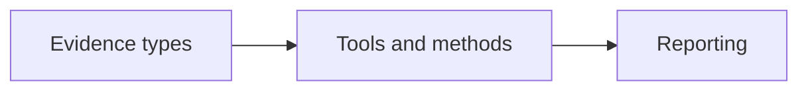

# IA 447 — Digital Forensics I

College coursework archive for **IA 447 — Digital Forensics I** at Eastern Michigan University.  
Forensic lab reports, case studies, steganography exercises, email and memory investigations.

**Author:** [Julio Barros](https://github.com/Jkbarros)  
**Index:** [college-projects](https://github.com/Jkbarros/college-projects)

## What is in this repository

| Area | Description |
|------|-------------|
| [`archive/canvas-submissions/`](archive/canvas-submissions/) | Case PDFs, registry/email/memory labs, steganography assignments |

### Highlights

- Daubert standard and Windows/memory/email forensic write-ups
- Steganography, EXIF, and file-signature labs
- Case studies (e.g. Audrey Simmons, Dante David, Sara Miles)

## Topics covered

## Related repos

| Course | Link |
|--------|------|
| IA 103 — Information Security Overview | [information-security-overview](https://github.com/Jkbarros/information-security-overview) |
| college-projects index | [college-projects](https://github.com/Jkbarros/college-projects) |

## Roadmap

- [ ] Convert key submissions to markdown in `docs/` (same pattern as IA 103)
- [ ] Redact any sensitive identifiers before expanding public docs

## Notes for readers

- This repo documents **my submitted work** for academic context only.
- EMU or publisher course materials are not redistributed beyond my own submissions in `archive/`.

## License

Content © Julio Barros. Use at your own risk.
