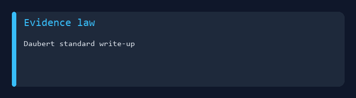
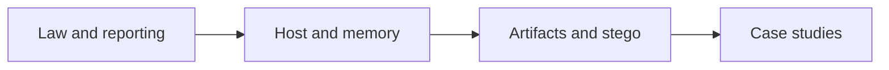

# IA 447 - Digital Forensics I



College coursework portfolio for **IA 447** at Eastern Michigan University.  
**Windows, memory, and email** investigations, **steganography** and **file recovery** labs, **Daubert** analysis, and **case study** reports.

**Author:** [Julio Barros](https://github.com/Jkbarros)  
**Index:** [college-projects](https://github.com/Jkbarros/college-projects)

## What is in this repository

| Area | Description |
|------|-------------|
| [Submissions catalog](docs/submissions-catalog.md) | Full index by theme |
| [Daubert standard](docs/applying-the-daubert-standard-to-forensic-evidence-4e-julio-barros.md) | Forensic evidence admissibility |
| [Windows forensics](docs/conducting-forensic-investigations-on-windows-systems-4e-julio-barros.md) | Host investigation write-up |
| [Memory forensics](docs/conducting-forensic-investigations-on-system-memory-4e-julio-barros.md) | RAM investigation lab |
| [Email & chat](docs/conducting-forensic-investigations-on-email-and-chat-logs-4e-julio-barros.md) | Messaging forensics |
| [Steganography](docs/recognizing-the-use-of-steganography-in-forensic-evidence-4e-julio-barros.md) | Hidden data in evidence |
| [File recovery](docs/recovering-deleted-and-damaged-files-4e-julio-barros.md) | Deleted/damaged files lab |
| [Case studies](docs/submissions-catalog.md#case-studies) | Audrey Simmons, Dante David, Sara Miles, Justin Casey |
| [Lab VM](docs/vm-lab-environment.md) | `vm.png` environment capture |
| [Archive index](docs/archive-index.md) | Original PDF/PNG in `archive/` |

### Highlights

- **17 PDF** submissions converted to markdown with inline screenshots (`docs/screenshots/`)
- Textbook-style **4e** chapter labs plus practical assignments and mock cases

## Topics covered



## Regenerate docs

```bash
pip install -r requirements.txt
python scripts/build_pdf_docs.py
python scripts/generate_readme_demo.py
```

Copy `archive/canvas-submissions/vm.png` to `docs/screenshots/vm.png` if missing after a fresh clone.

## Related repos

| Course | Link |
|--------|------|
| IA 445 - Ethical Hacking | [ia445-ethical-hacking-offensive-security](https://github.com/Jkbarros/ia445-ethical-hacking-offensive-security) |
| IA 455 - Incident Response | [incident-response-ia455](https://github.com/Jkbarros/incident-response-ia455) |
| college-projects index | [college-projects](https://github.com/Jkbarros/college-projects) |

## Notes for readers

- Academic forensic exercises only; case narratives are course fiction unless cited otherwise.
- EMU or publisher materials are not redistributed beyond my submissions in `archive/`.

## License

Content © Julio Barros. Use at your own risk.
