# Applying the Daubert Standard to Forensic Evidence 4e - Julio Barros

**Source:** [`Applying_the_Daubert_Standard_to_Forensic_Evidence_4e_-_Julio_Barros.pdf`](../archive/canvas-submissions/Applying_the_Daubert_Standard_to_Forensic_Evidence_4e_-_Julio_Barros.pdf)  
**Course:** IA 447 - Digital Forensics I (EMU)  
**Author:** Julio Barros

## Page 1

Applying the Daubert Standard to Forensic Evidence (4e)
Digital Forensics, Investigation, and Response, Fourth Edition - Lab 01
Student: Email:
Julio Barros
Time on Task: Progress:
1 hour, 55 minutes 100%
Report Generated: Tuesday, September 12, 2023 at 7:42 PM
Section 1: Hands-On Demonstration
Part 1: Complete Chain of Custody Procedures
7. Make a screen capture showing the contents of the search warrant in Adobe Reader.
Page 1 of 9

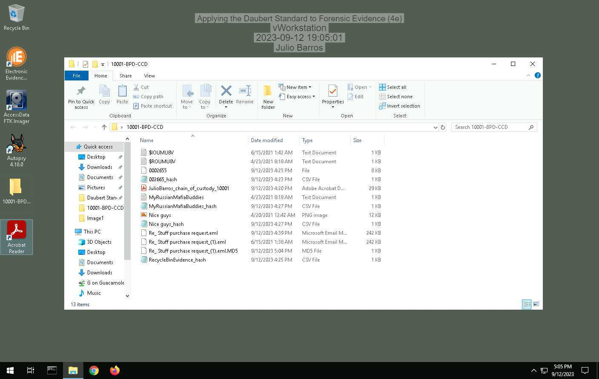

## Page 2

Applying the Daubert Standard to Forensic Evidence (4e)
Digital Forensics, Investigation, and Response, Fourth Edition - Lab 01
14. Make a screen capture showing the completed Chain of Custody form in Adobe Reader.
Part 2: Extract Evidence Files and Create Hash Codes with FTK Imager
34. Make a screen capture showing the contents of the 0002665_hash.csv file.
Page 2 of 9

## Page 3

Applying the Daubert Standard to Forensic Evidence (4e)
Digital Forensics, Investigation, and Response, Fourth Edition - Lab 01
37. Make a screen capture showing the contents of the RecycleBinEvidence_hash.csv file.
38. Make a screen capture showing the contents of the MyRussianMafiaBuddies_hash.csv
file.
Page 3 of 9

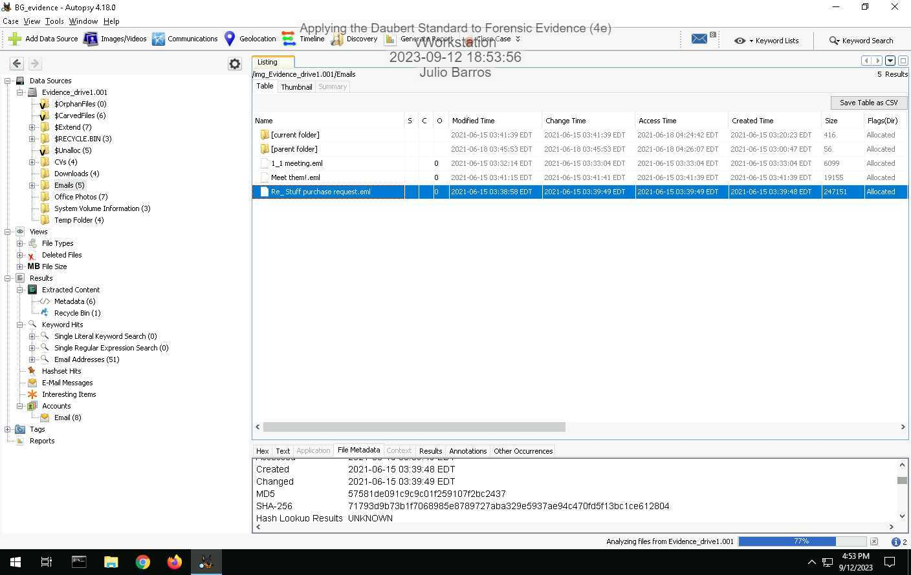

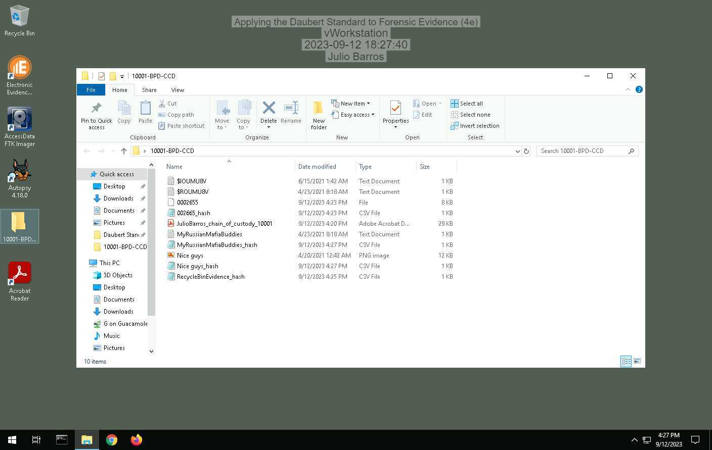

## Page 4

Applying the Daubert Standard to Forensic Evidence (4e)
Digital Forensics, Investigation, and Response, Fourth Edition - Lab 01
39. Make a screen capture showing the contents of the Nice guys_hash.csv file.
Part 3: Verify Hash Codes with E3
14. Make a screen capture showing the MD5 and SHA1 values for the
MyRussianMafiaBuddies.txt file.
Page 4 of 9

## Page 5

Applying the Daubert Standard to Forensic Evidence (4e)
Digital Forensics, Investigation, and Response, Fourth Edition - Lab 01
16. Make a screen capture showing the MD5 and SHA1 values for the Nice Guys.png file.
17. Describe how the hash values produced by E3 for the incriminating files compare to those
produced by FTK. Do they match?
No they don't match
Page 5 of 9

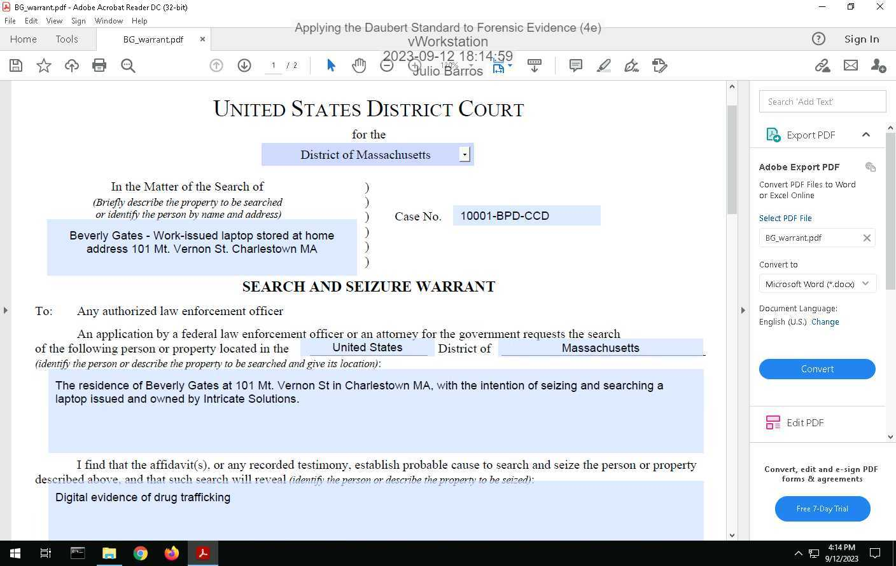

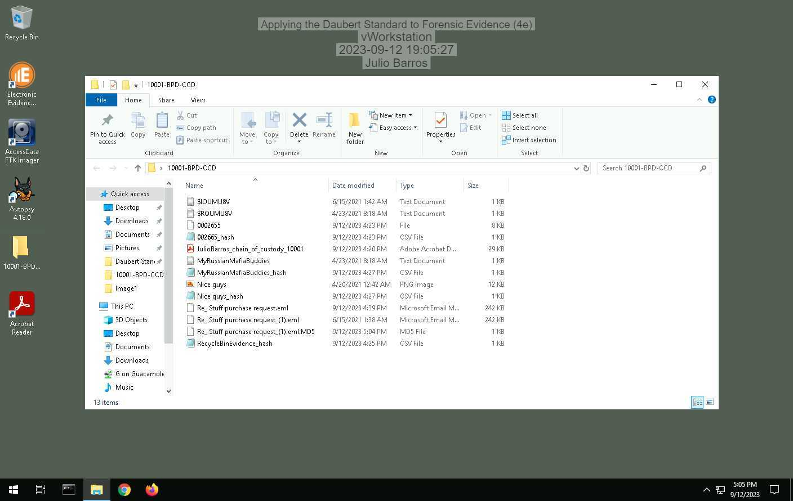

## Page 6

Applying the Daubert Standard to Forensic Evidence (4e)
Digital Forensics, Investigation, and Response, Fourth Edition - Lab 01
Section 2: Applied Learning
Part 1: Extract Evidence Files and Create Hash Codes with FTK Imager
5. Make a screen capture showing the contents of the suspicious email file in the Display
pane.
Page 6 of 9

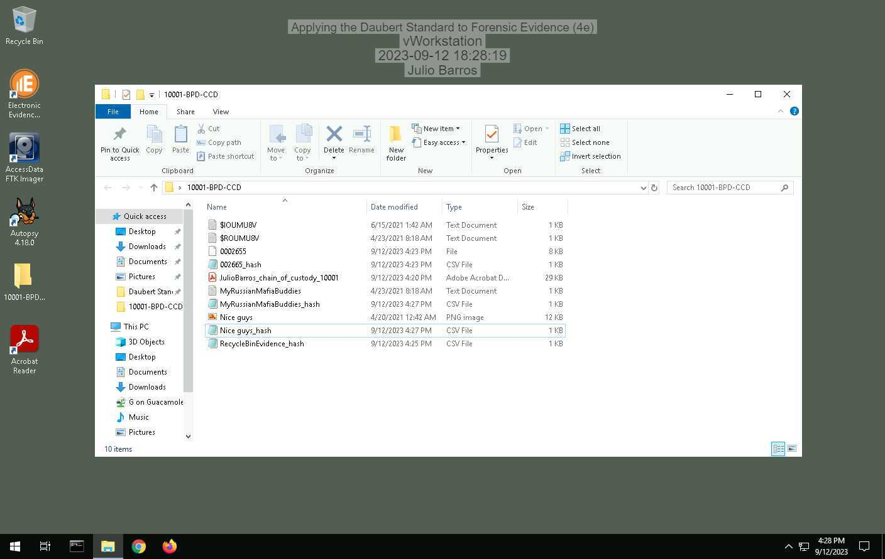

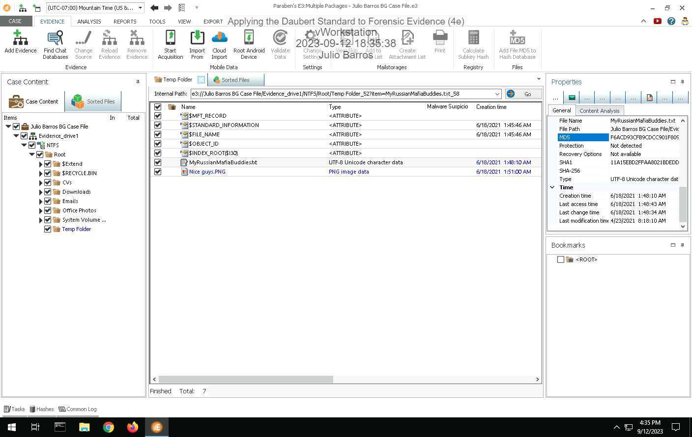

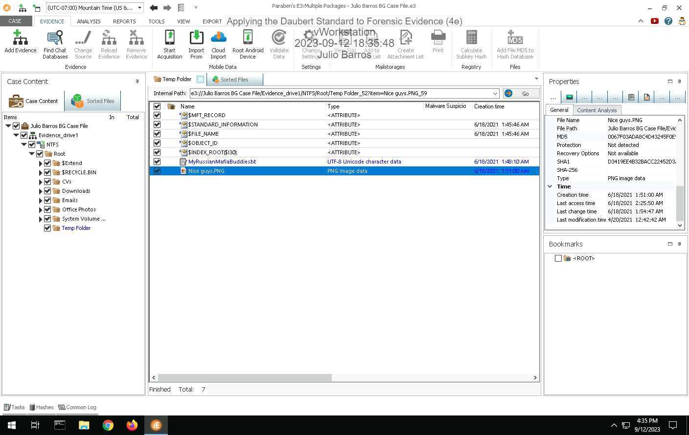

## Page 7

Applying the Daubert Standard to Forensic Evidence (4e)
Digital Forensics, Investigation, and Response, Fourth Edition - Lab 01
16. Make a screen capture showing the two hash values for the suspicious email file.
Part 2: Verify Hash Codes with Autopsy
11. Make a screen capture showing the MD5 field in the Result Viewer.
Page 7 of 9

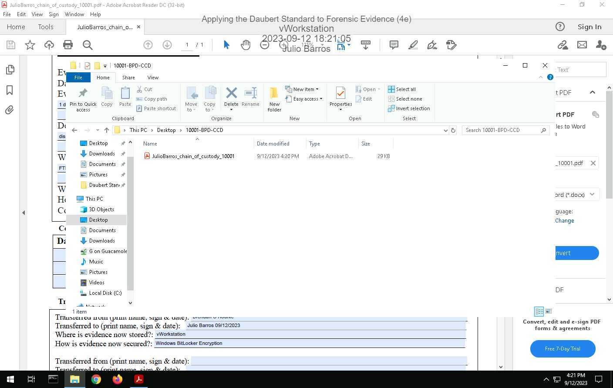

## Page 8

Applying the Daubert Standard to Forensic Evidence (4e)
Digital Forensics, Investigation, and Response, Fourth Edition - Lab 01
12. Describe how the hash value produced by Autopsy compares to the values produced by FTK
Imager for the two .eml files.
Both hash are different, even when they were created in the same machine and similar time.
Part 3: Verify Hash Codes with E3
7. Make a screen capture showing the MD5 value produced by E3.
8. Describe how the hash value produced by E3 compares to the values produced by FTK
Imager for the two .eml files and the value produced by Autopsy.
All Hash are same combination
Page 8 of 9

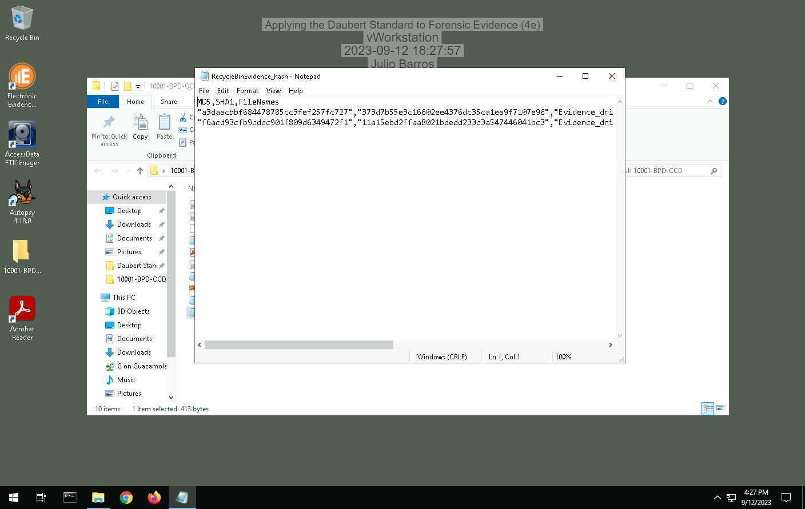

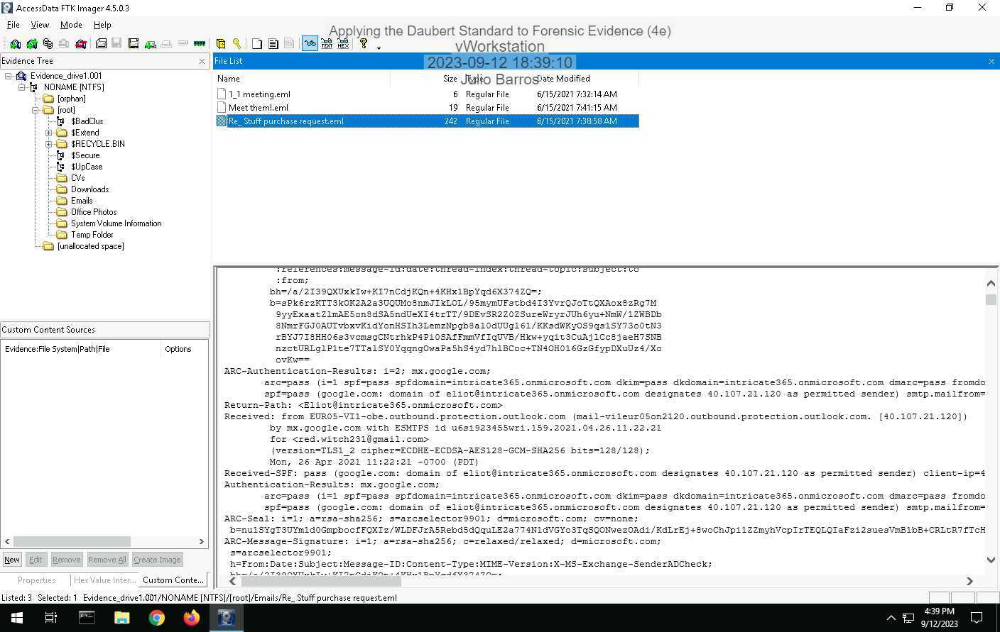

## Page 9

Applying the Daubert Standard to Forensic Evidence (4e)
Digital Forensics, Investigation, and Response, Fourth Edition - Lab 01
Section 3: Challenge and Analysis
Part 1: Verify Hash Codes on the Command Line
Make a screen capture showing the hash values for the Evidence_drive1.001 file.
Part 2: Locate Additional Evidence
Define the original file names and file paths for each of the three files.
Fist of all I had to go to the view option on the Autopsy and look up for pdf files, after finding the
$RX3177E.pdf, I went to the file properties and look up for the file local where showed me the recycle
bin, where I was able to find the other two files as well.
Powered by TCPDF (www.tcpdf.org)
Page 9 of 9

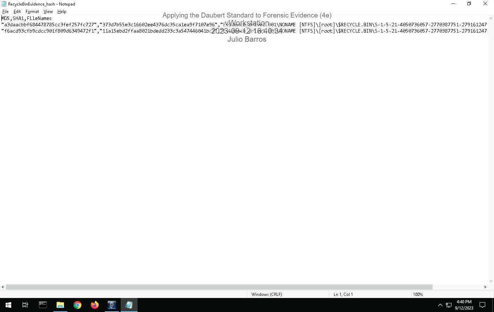

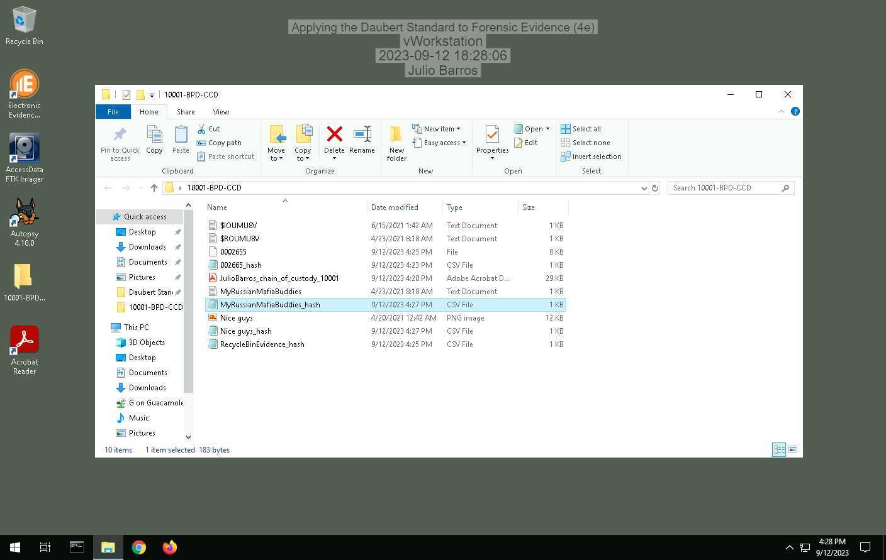

