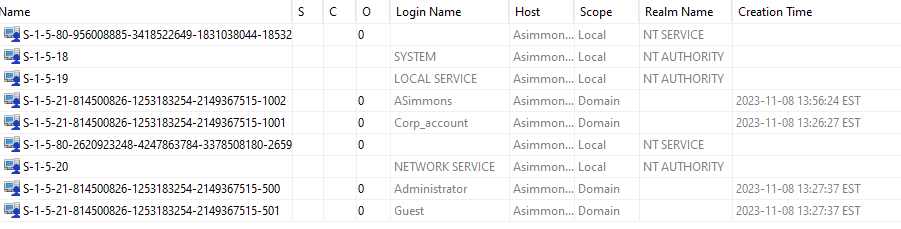
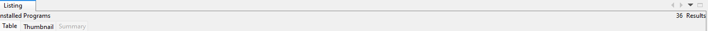
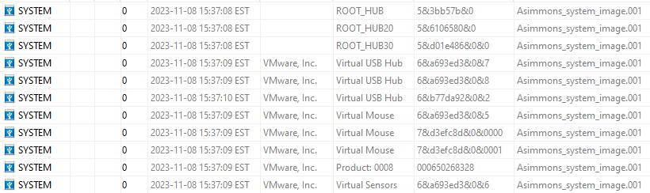

# Audrey Simmons case

**Source:** [`Audrey Simmons case.pdf`](../archive/canvas-submissions/Audrey%20Simmons%20case.pdf)  
**Course:** IA 447 - Digital Forensics I (EMU)  
**Author:** Julio Barros

## Page 1

IA-427 
Forensics Report 
 Internal Case 
Audrey Simmons 
Incident Status: In progress 
Report written by: 
Julio Barros 
Revision: 1 
 
 
Read the document carefully – I have removed some required sections in a full report and 
streamlined others.  I’ve done this to reduce your assignment time but keep the main 
components. Every section that is highlighted needs your input. When outlining your artifacts, 
include the elements covered in class.  You may or may not find all artifacts, but keep the report 
in artifact order by computer image and USB image (see below) 
 
1. Download “Simmons_USB.zip” and “System image Audry Simmons.rar”   share;  
2. FYI - You could install any tools (Autopsy, WRR, hex tool, etc.)  you want to use directly on your 
OS and save the overhead of a virtual machine.

## Page 2

IA-427 
Forensics Report 
 Internal Case 
Audrey Simmons 
Incident Status: In progress 
Report written by: 
Julio Barros 
Revision: 1 
 
 
=============================================================================== 
Executive Summary  
Tasha Jennings is the CEO of Art for the Public (AP), a company that navigates all the processes 
needed to display multi-million-dollar paintings on loan from private collectors.  Audrey Simons 
has been an employee of AP for 12 years in the role of Art Restoration Specialist and reports 
directly to Tasha. Audrey holds advanced degrees in computer science and art history. Audrey’s 
duties include advanced expertise in digitally restoring paintings to reduce the effects of aging.  
Under AP payroll, Audrey developed a unique application that makes restoration easier, 
mitigates risk, and offers many more modern updates than previous methods.  The program is 
invaluable and could be worth millions as a resale application brought to the public market. AP 
intends to keep the application in-house and treat it as a competitive advantage.  Audrey has 
been vocal about being under-appreciated and under-compensated.  AP has learned that 
somebody inside the company has been planning to steal the code for the application and 
introduce it as a new product. AP leadership has enough intel to collect information on 
Audrey’s computer habits to see if she may be involved.  Audrey will not be informed of the 
investigation. Tasha has asked you to review Audrey’s computer and associated hardware for 
any evidence suggesting involvement in the planning of intellectual property theft or breach of 
AP policy. 
Without her knowledge, a bitstream gold copy of Audrey’s computer has been made, and you 
are being provided with a copy.  While the copy was being made, a USB drive was identified in 
Audrey’s office, and an image was made.  The chain of evidence is intact and not part of this 
investigation. 
Nature of the case: Suspicion of employee planned or active IP theft. 
==================================== 
The information security policies in the company include the following:  
1) Any use of removable media is prohibited at AP. 
2) All computing resources will be used for work purposes only. 
3) Any documents stored on or created by AP technology resources belong solely to AP. 
4) Confidential paper documents and electronic files are the sole property of AP and 
should not be distributed outside of the company. Examples are patents, programming 
code, formulas, trade secrets, customer lists, unpublished financial information, and 
employee work products.

## Page 3

IA-427 
Forensics Report 
 Internal Case 
Audrey Simmons 
Incident Status: In progress 
Report written by: 
Julio Barros 
Revision: 1 
 
 
5) Employees may not transfer data from AP to other devices or accounts. When a mass 
transfer of such data is needed, we request employees to ask our [Security Specialists] 
for help. 
6) No use of removable storage devices is permitted. 
7) Employees must report all suspected (digital or otherwise) scams, privacy breaches, and 
hacking attempts. 
8) All AP employee-created data must be stored on AP secure servers and accessed via a 
client. No download of any AP materials is permitted. This means no local storage of any 
kind. 
9) AP reserves the right to investigate any hardware used in a company function.  This 
includes personal devices attached to AP resources, such as a personal cell phone. 
10) AP Corporate issued documents are approved for local storage.   
Things to be aware of for your investigation: 
1) You may assume the USB belongs to Audrey Simmons. 
2) Any local image of a painting is evidence of possible IP theft. 
3) Some artifacts will be labeled “Corporate Issued” and should be investigated but are not 
positive evidence of a case by themselves.  These documents are in place to simulate 
documents provided by AP and are acceptable for local storage( policy #10 above).  
They may contain evidence of the case in the format of file signature changes, 
steganography, or other forms of suspect tampering. 
4) There are eleven artifacts in the system image and USB image.   While the artifacts are 
numbered, there may be numbers missing in the sequence.  In other words, Artifact 1 
may not be in the image, but there are 10 artifacts.  You are expected to report the 
artifacts in order using the format below.  The eleventh artifact, Artifact 16, is extra 
credit. 
5) Ignore date and time stamps in your investigation. I changed the image to allow 
distribution over Google Share, and all dates/times are rest to the last 24 hours. 
6) A rubric for the exam can be located in Canvas

## Page 4

IA-427 
Forensics Report 
 Internal Case 
Audrey Simmons 
Incident Status: In progress 
Report written by: 
Julio Barros 
Revision: 1 
 
 
1 Incident Discovery (Section of report not needed for this assignment) 
         Description of system(s) in 
 (Section of report not needed for this assignment)File System: FAT12 
2 Forensics Process 
2.1 Tools (list tools) 
a. 4.1.2 Autopsy 4.12.0 Autopsy is an open-source digital forensics toolkit used to process images 
of hard drives and removable USB devices. It has many plugins to assist analysis in processing 
and reviewing data. 
See http://www.sleuthkit.org/autopsy/ for additional information or a copy of the software. 
b. WinMD5Free 1.20 
This utility was used to verify and monitor the integrity of the files during the investigation. 
See http://www.winmd5.com/

## Page 5

IA-427 
Forensics Report 
 Internal Case 
Audrey Simmons 
Incident Status: In progress 
Report written by: 
Julio Barros 
Revision: 1 
 
 
 
4. Results and Findings (follow this outline in your report. Report as we’ve done in previous full cases) 
4.1  What artifacts are recoverable from the computer image? Comments?  
• Artifact # 7 – $ROT0OVH.jpg 
• Artifact # 13 – Important.pdf 
• Artifact # 14 – Doc2.docx 
• Artifact # 12 – gothic.pdf 
• Artifact # 15 – Detroit.jpg  
• 4.2  What artifacts are recoverable from the image of the USB drive? 
Comments? 
• Artifact #1  -nicepic.jnp 
• Artifact #2  -State_of_liberty.jnp 
• Artifact #3  - needle.jpg 
4.4  Does a review of the system image confirm that anti-forensic techniques were used on the Simons 
computer?   
Recovery of Deleted Data: 
Analyze the file system to identify and recover deleted files. Some anti-forensic techniques involve the 
deletion of files to hinder investigation. 
Unallocated Space Analysis: 
Examine unallocated space on the disk for remnants of deleted files, as well as artifacts left by anti-
forensic tools or techniques. 
Steganography Detection: 
Look for signs of steganography, which involves hiding data within other seemingly innocuous files. 
Specialized tools may be needed to detect hidden information. 
Timeline Analysis: 
Create a timeline of system events to identify any anomalies or gaps. Anti-forensic techniques may 
involve altering timestamps or deleting logs. 
Analysis of System Artifacts: 
Investigate system artifacts, such as the Windows Registry, event logs, and prefetch files, to identify any 
abnormal activities or changes. 
Memory Analysis:Analyze system memory for signs of running processes, injected code, or other 
indications of malware or anti-forensic tools.

## Page 6

IA-427 
Forensics Report 
 Internal Case 
Audrey Simmons 
Incident Status: In progress 
Report written by: 
Julio Barros 
Revision: 1 
 
 
4.5  registry 
• Screengrab the user accounts on the image 
 
• Screengrab OS version number (windows) 
 
• Screengrab Installed software. There are 36 programs installed. 
 
• Screengrab the assigned IP on the computer 
o 23.201.57.87  
 
 
• Did Simmons use a removable device? Yes, Simmons used 5 different devices according 
to the device ID. 
 
• What protocols are running on the computer? Screengrab the registry key and comment

## Page 7

IA-427 
Forensics Report 
 Internal Case 
Audrey Simmons 
Incident Status: In progress 
Report written by: 
Julio Barros 
Revision: 1 
 
 
4.3      Conclusion 
After a comprehensive analysis of the provided documents and digital artifacts, it is challenging 
to reach a definitive conclusion regarding the guilt or innocence of the client. The evidence 
examined does not clearly establish a direct link to the alleged activities or may present 
ambiguity that hinders a conclusive determination. While certain findings may raise questions 
or concerns, the available information falls short of providing unequivocal proof of guilt. 
Further investigation, additional evidence, or expert analysis may be required to arrive at a 
more conclusive assessment.

