# Conducting Forensic Investigations on Email and Chat Logs 4e - Julio Barros

**Source:** [`Conducting_Forensic_Investigations_on_Email_and_Chat_Logs_4e_-_Julio_Barros.pdf`](../archive/canvas-submissions/Conducting_Forensic_Investigations_on_Email_and_Chat_Logs_4e_-_Julio_Barros.pdf)  
**Course:** IA 447 - Digital Forensics I (EMU)  
**Author:** Julio Barros

## Page 1

Conducting Forensic Investigations on Email and Chat Logs (4e)
Digital Forensics, Investigation, and Response, Fourth Edition - Lab 07
Student: Email:
Julio Barros jribeir2@emich.edu
Time on Task: Progress:
1 hour, 17 minutes 100%
Report Generated: Wednesday, November 22, 2023 at 11:30 AM
Section 1: Hands-On Demonstration
Part 1: Analyze Email Headers
17. Make a screen capture showing the Happy Reminder email in the Text Viewer and
Timestamp in the Properties pane.
Page 1 of 9

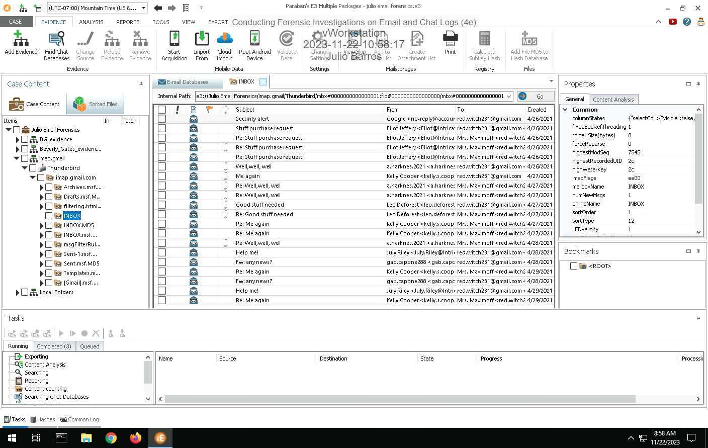

## Page 2

Conducting Forensic Investigations on Email and Chat Logs (4e)
Digital Forensics, Investigation, and Response, Fourth Edition - Lab 07
22. Make a screen capture showing the IP address of the sender.
Part 2: Search for Evidence in an Outlook Database
7. Make a screen capture showing the list of files in the Graphics category.
Page 2 of 9

## Page 3

Conducting Forensic Investigations on Email and Chat Logs (4e)
Digital Forensics, Investigation, and Response, Fourth Edition - Lab 07
21. Make a screen capture showing the email that references the Big Boss.
Part 3: Search for Evidence in a Slack Database
7. Make a screen capture showing the members of the IntricateSolutions workspace.
Page 3 of 9

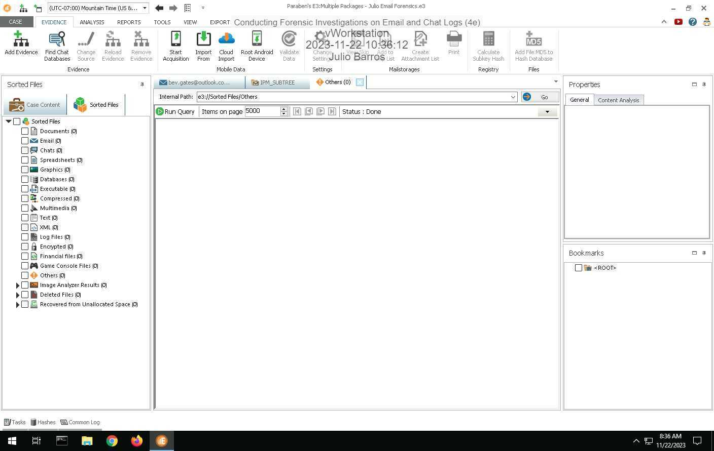

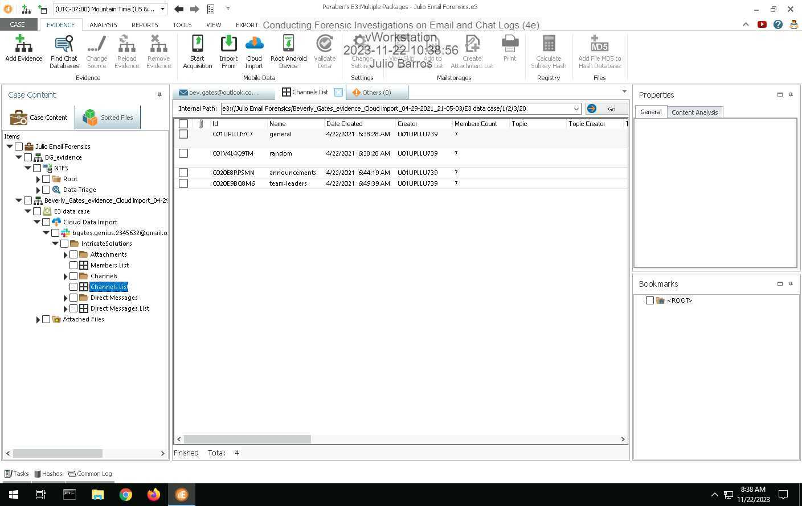

## Page 4

Conducting Forensic Investigations on Email and Chat Logs (4e)
Digital Forensics, Investigation, and Response, Fourth Edition - Lab 07
9. Make a screen capture showing the channels in the IntricateSolutions workspace.
13. Make a screen capture showing the conversation contents.
Page 4 of 9

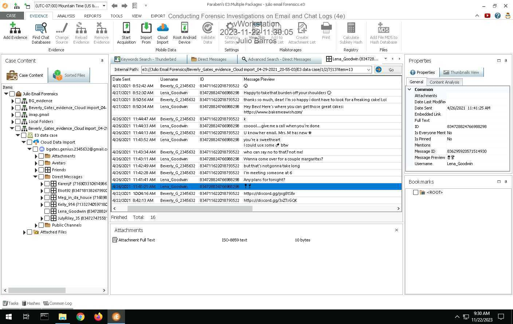

## Page 5

Conducting Forensic Investigations on Email and Chat Logs (4e)
Digital Forensics, Investigation, and Response, Fourth Edition - Lab 07
Section 2: Applied Learning
Part 1: Import a Thunderbird Email Database
15. Make a screen capture showing the Thunderbird Inbox.
17. Document the sender's email address, mail server name, and mail server IP address in the
Well, Well, Well email header.
185.70.40.140
Part 2: Search for Evidence in a Thunderbird Database
Page 5 of 9

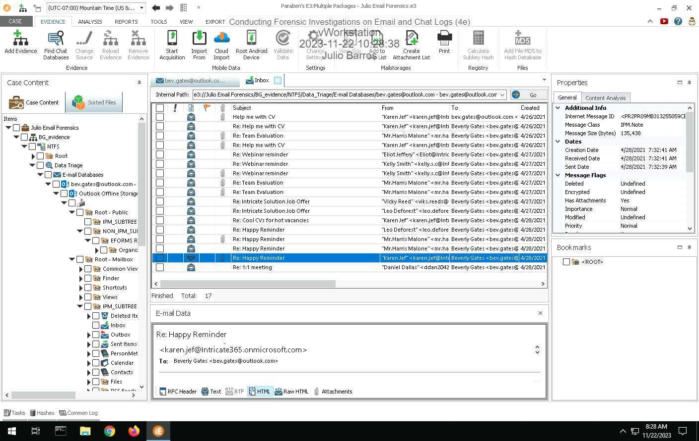

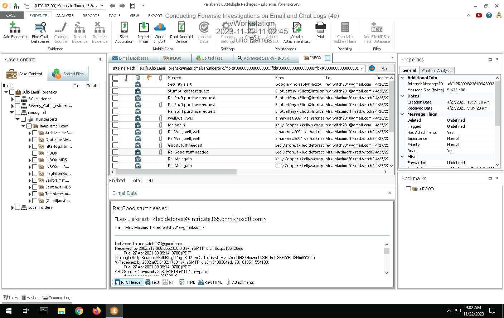

## Page 6

Conducting Forensic Investigations on Email and Chat Logs (4e)
Digital Forensics, Investigation, and Response, Fourth Edition - Lab 07
5. Make a screen capture showing the email from Leo Deforest.
11. Make a screen capture showing the pills evidence and Beverly Gates corresponding as
Natasha "Red" Maximoff.
Part 3: Search for Evidence in a Discord Database
Page 6 of 9

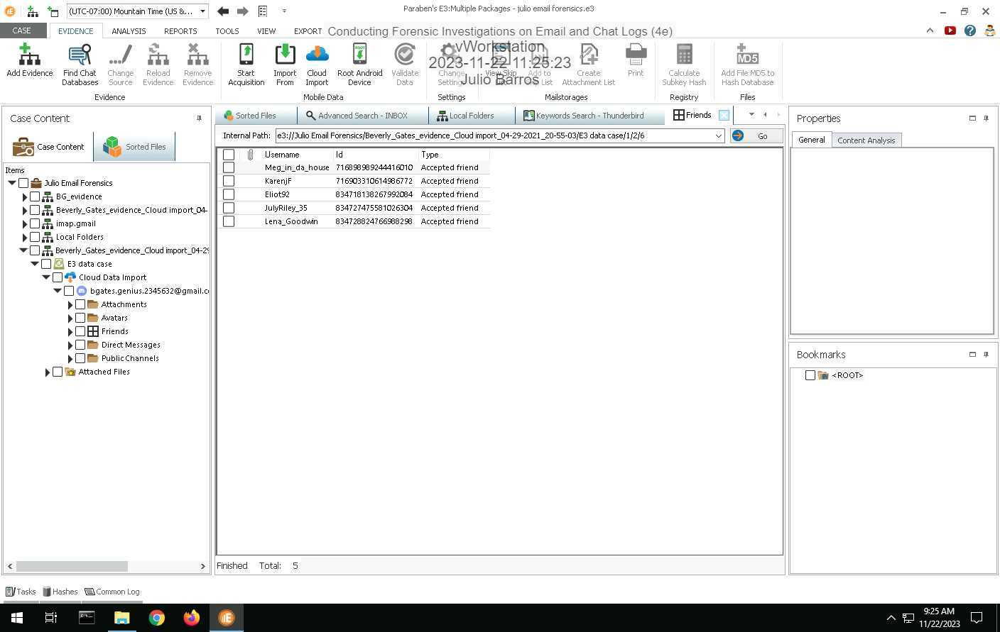

## Page 7

Conducting Forensic Investigations on Email and Chat Logs (4e)
Digital Forensics, Investigation, and Response, Fourth Edition - Lab 07
4. Make a screen capture showing Beverly's Discord friend list.
8. Make a screen capture showing the Lena Goodwin conversation.
Page 7 of 9

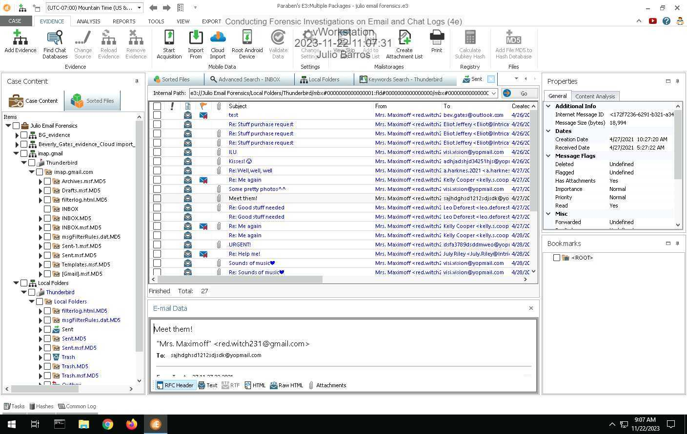

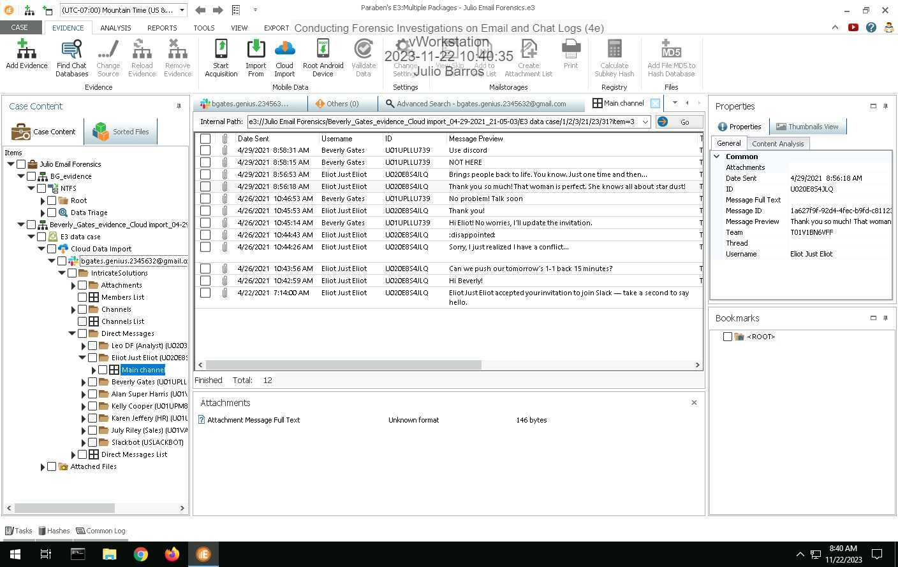

## Page 8

Conducting Forensic Investigations on Email and Chat Logs (4e)
Digital Forensics, Investigation, and Response, Fourth Edition - Lab 07
Section 3: Challenge and Analysis
Part 1: Search for Additional Email Evidence
Make a screen capture showing the email thread returned in the search results.
Part 2: Search for Additional Chat Evidence
Page 8 of 9

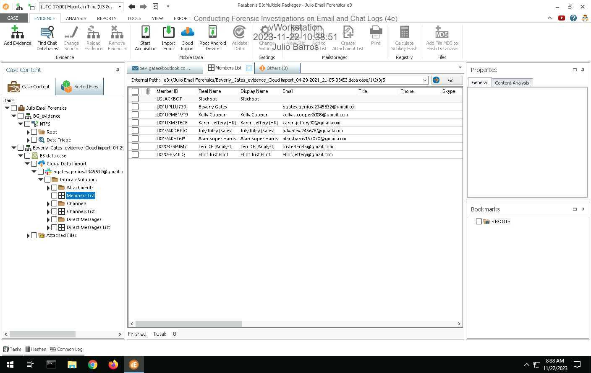

## Page 9

Conducting Forensic Investigations on Email and Chat Logs (4e)
Digital Forensics, Investigation, and Response, Fourth Edition - Lab 07
Make a screen capture showing the additional evidence within the Discord database
Powered by TCPDF (www.tcpdf.org)
Page 9 of 9

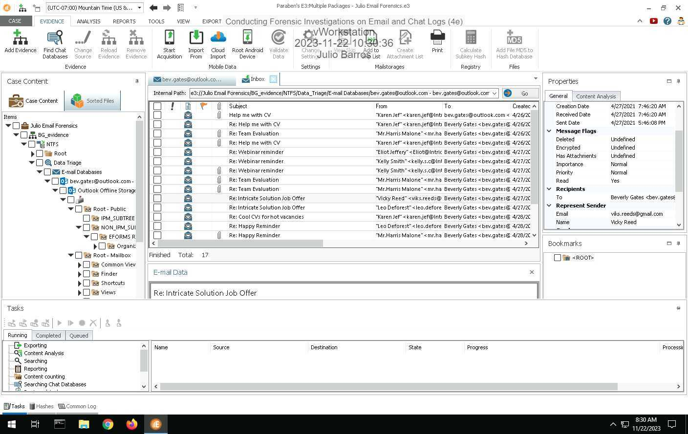

