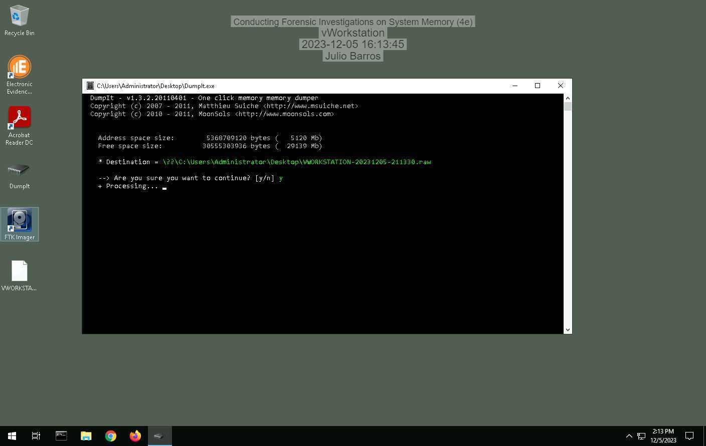
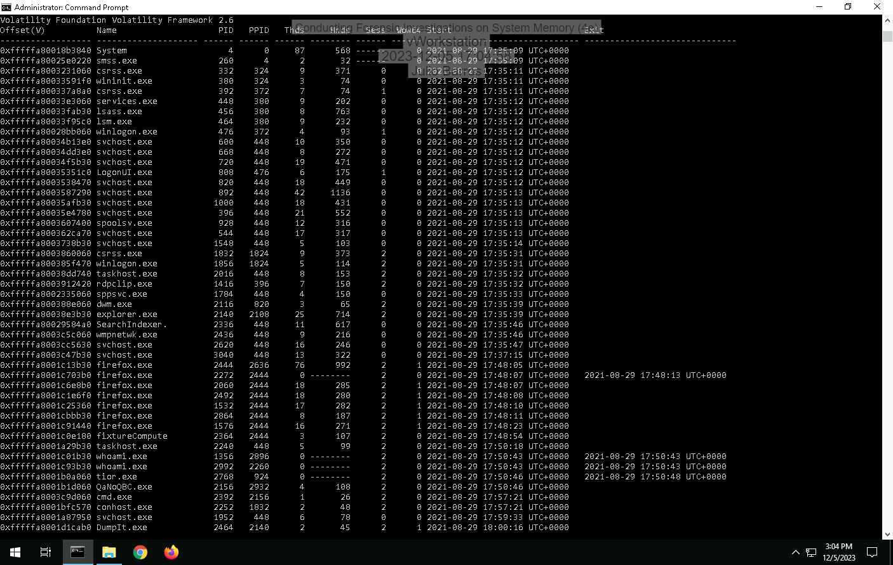
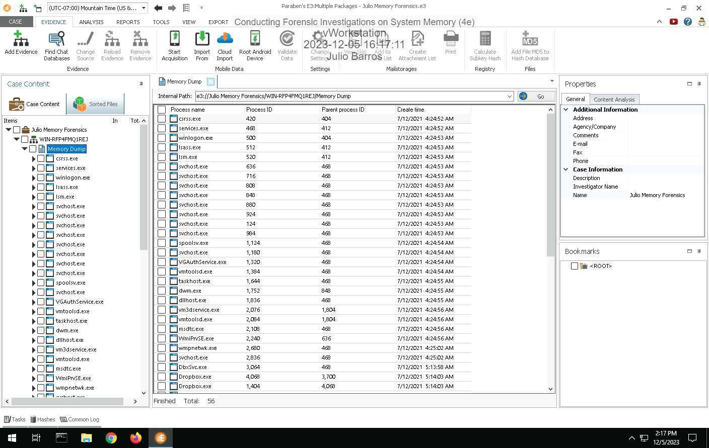
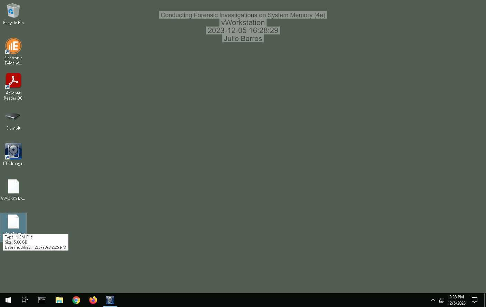
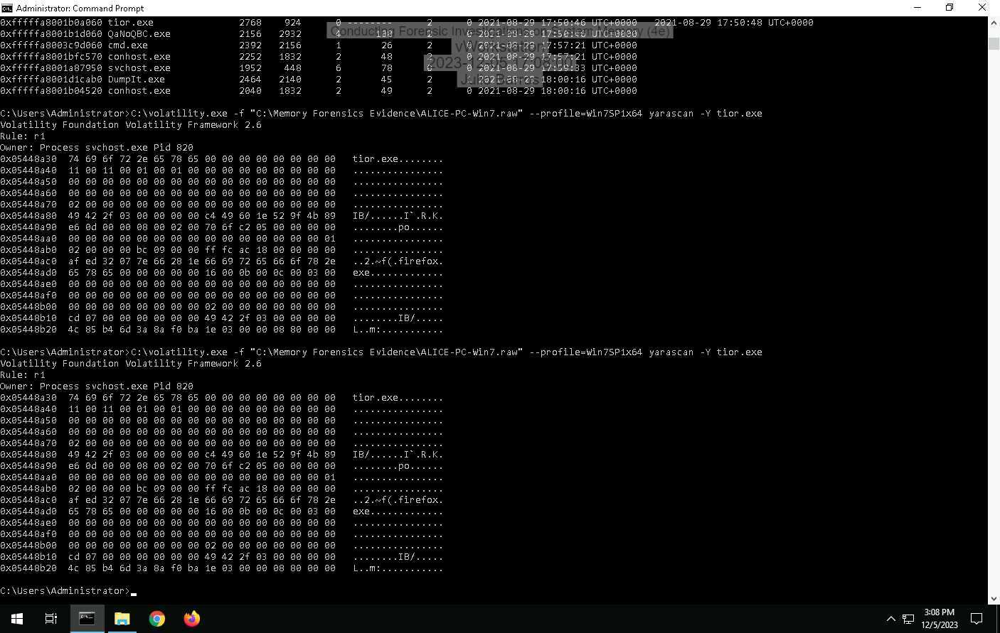
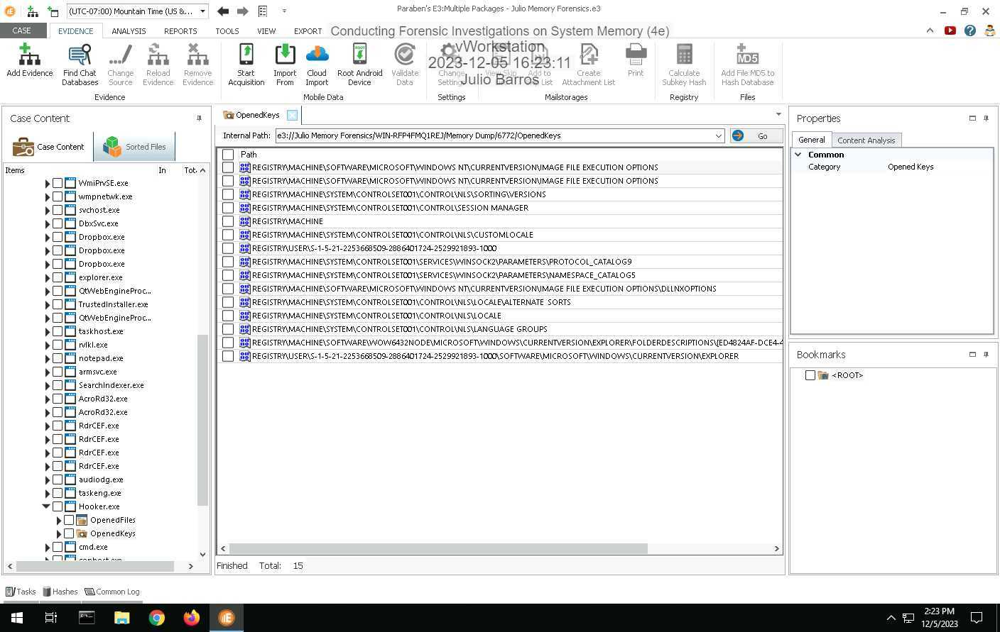
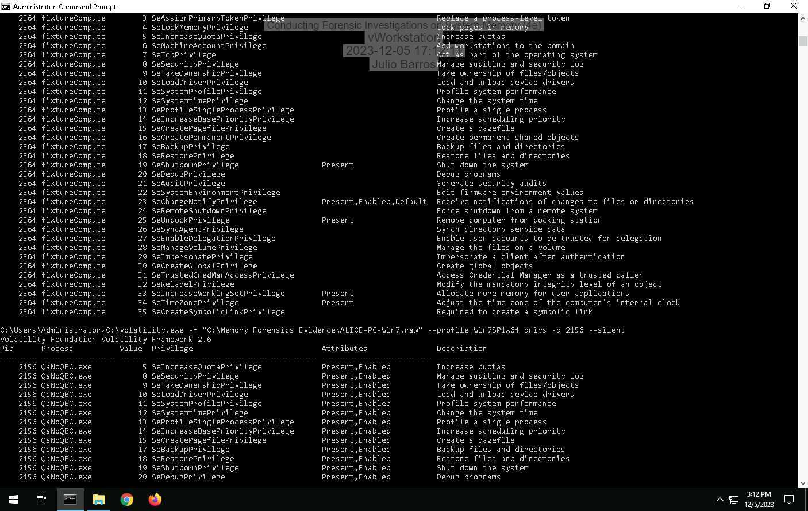
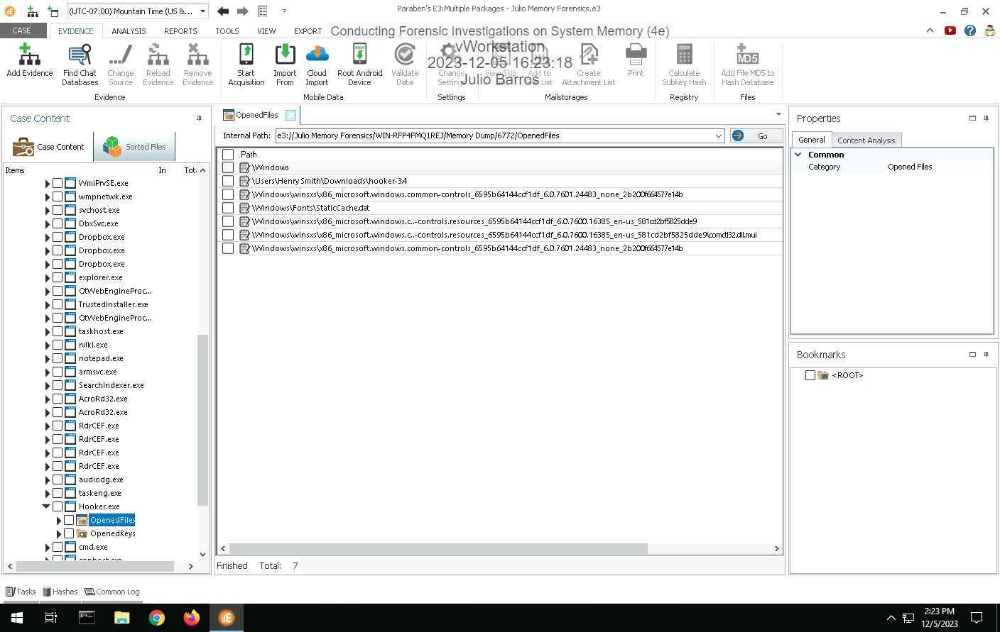
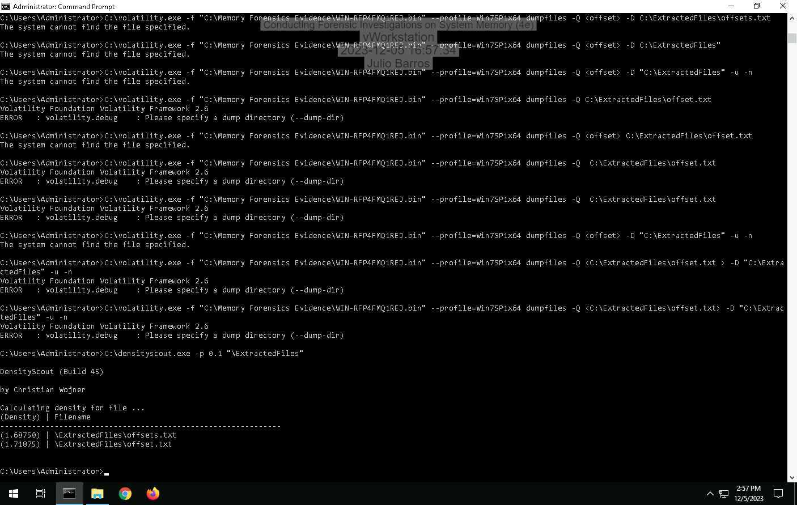

# Conducting Forensic Investigations on System Memory 4e - Julio Barros

**Source:** [`Conducting_Forensic_Investigations_on_System_Memory_4e_-_Julio_Barros.pdf`](../archive/canvas-submissions/Conducting_Forensic_Investigations_on_System_Memory_4e_-_Julio_Barros.pdf)  
**Course:** IA 447 - Digital Forensics I (EMU)  
**Author:** Julio Barros

## Page 1

Conducting Forensic Investigations on System Memory (4e)
Digital Forensics, Investigation, and Response, Fourth Edition - Lab 10
Student: Email:
Julio Barros
Time on Task: Progress:
1 hour, 1 minute 100%
Report Generated: Tuesday, December 5, 2023 at 5:12 PM
Section 1: Hands-On Demonstration
Part 1: Capture Memory using DumpIt
3. Make a screen capture showing the DumpIt success notification.
Part 2: Analyze Memory using E3
Page 1 of 9

## Page 2

Conducting Forensic Investigations on System Memory (4e)
Digital Forensics, Investigation, and Response, Fourth Edition - Lab 10
8. Make a screen capture showing the list of processes in the memory dump.
10. Record the start times for the oldest process and the newest process.
Oldest = 7/12/2021 4:24:49 AM
Newest = 7/12/2021 6:42:43 AM
15. Document your findings for the conhost.exe process. What is it and what is it used for?
The Windows Console Host is the server application for all of the Windows APIs as well the classic
Windows user interface for working with command-line Applications
17. Document your findings for the hooker.exe process. What is it and what is it used for?
hooker.exe is a password and data stealing trojan.
Page 2 of 9

## Page 3

Conducting Forensic Investigations on System Memory (4e)
Digital Forensics, Investigation, and Response, Fourth Edition - Lab 10
21. Make a screen capture showing the registry keys opened by the Hooker.exe process.
23. Make a screen capture showing the files opened by the hooker.exe process.
Page 3 of 9

## Page 4

Conducting Forensic Investigations on System Memory (4e)
Digital Forensics, Investigation, and Response, Fourth Edition - Lab 10
Section 2: Applied Learning
Part 1: Capture Memory using FTK Imager
6. Make a screen capture showing the Memory capture finished successfully confirmation.
Part 2: Analyze Memory using Volatility
Page 4 of 9

## Page 5

Conducting Forensic Investigations on System Memory (4e)
Digital Forensics, Investigation, and Response, Fourth Edition - Lab 10
7. Document your findings for the rvlkl.exe process. What is it and what is it used for?
Rvlkl.exe is an executable exe file that belongs to the
Revealer Keylogger process which comes along with the
Revealer Keylogger Software developed by Logixoft software
developer. Revealer Keylogger is a program that allows you to
monitor the keystrokes typed on your computer, such as
passwords, chat messages, emails, and web searches. It can
also take screenshots of your desktop and send them to a
remote server or email address. Revealer Keylogger is
marketed as a parental control or employee monitoring tool,
but it can also be used for malicious purposes by hackers or
spies.
9. Document whether any processes are flagged as hidden.
No
12. Document whether the netscan module displays network usage associated with the
Hooker.exe or rvlkl.exe processes.
There is no sign of Hooker or rvlkl processes
15. Document any information you were able to gather about port 56610.
TCP port 56610 uses the Transmission Control Protocol. TCP is one of the main protocols in TCP/IP
networks. TCP is a connection-oriented protocol, it requires handshaking to set up end-to-end
communications.
Page 5 of 9

## Page 6

Conducting Forensic Investigations on System Memory (4e)
Digital Forensics, Investigation, and Response, Fourth Edition - Lab 10
26. Make a screen capture showing the DensityScout results.
Page 6 of 9

## Page 7

Conducting Forensic Investigations on System Memory (4e)
Digital Forensics, Investigation, and Response, Fourth Edition - Lab 10
Section 3: Challenge and Analysis
Part 1: Identify Malicious Connections
Document the three processes that connected to 205.134.253.10:4444.
Is the offset ox7fa9a3d0 currently closed to the dllhost.exe
Document the name and purpose of the software you discovered.
It uses this port to eavesdrop on traffic and communications, for its communications, and to receive
data from the compromised computer. Malware such as the Blaster worm and its variants used port
4444 to create backdoors.
Part 2: Identify Malicious Processes
Make a screen capture showing the fixtureComputer.exe process, and all those below it, in the
pslist output.
Page 7 of 9

## Page 8

Conducting Forensic Investigations on System Memory (4e)
Digital Forensics, Investigation, and Response, Fourth Edition - Lab 10
Make a screen capture showing the output of the yarascan.
Part 3: Identify Privilege Escalation
Make a screen capture showing the output of your privilege comparison.
Page 8 of 9

## Page 9

Conducting Forensic Investigations on System Memory (4e)
Digital Forensics, Investigation, and Response, Fourth Edition - Lab 10
Powered by TCPDF (www.tcpdf.org)
Page 9 of 9

