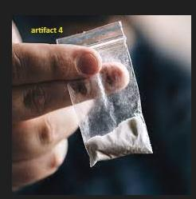
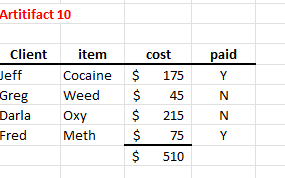
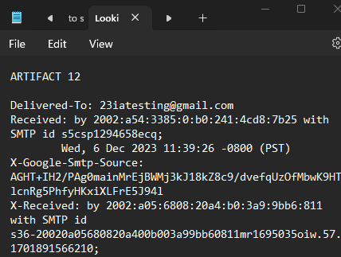
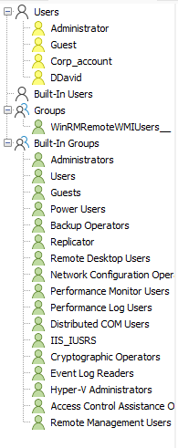
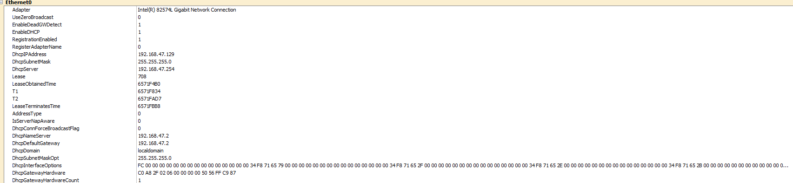
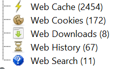
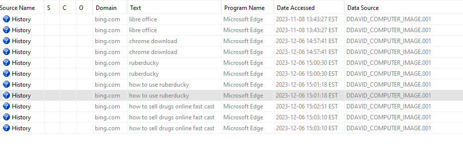
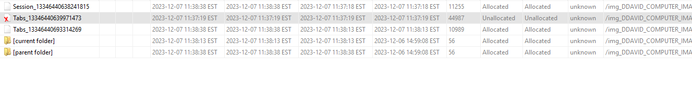
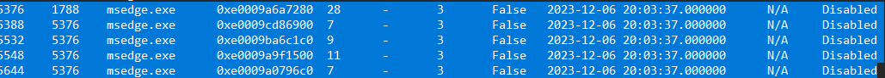

# Dante David case

**Source:** [`Dante David case.pdf`](../archive/canvas-submissions/Dante%20David%20case.pdf)  
**Course:** IA 447 - Digital Forensics I (EMU)  
**Author:** Julio Barros

## Page 1

IA-427 
Forensics Report 
 Internal Case 
Dante David 
Incident Status: In progress 
Report written by: 
Julio Barros 
Revision: 1 
 
 
Read the document carefully – I have removed some required sections in a full report and 
streamlined others.  I’ve done this to reduce your assignment time but keep the main 
components. Every section that is highlighted needs your input. When outlining your artifacts, 
include the elements covered in class.  You may or may not find all artifacts, but keep the report 
in artifact order by computer image and USB image (see below) 
 
1. Download “Dante David Case\Ddavid_computer_image.zip” and  “DDavid Memdump” share;  
2. FYI - You could install any tools (Autopsy, WRR, hex tool, etc.)  you want to use directly on your 
OS and save the overhead of a virtual machine.   
 
=============================================================================== 
Executive Summary  
Dante David, an employee at ABC Incorporated, is being looked for selling drugs using 
corporate resources.  Normally, corporate investigators would not handle a criminal case, but 
we’ll move forward in this case.  You have been provided with an image of the David computer 
and active RAM. 
 
Things to be aware of for your investigation: 
1) Any images of drugs or drug-related material are considered evidence in this case. 
Review all artifacts using the same methodology done in the Audrey Simmons case. 
 
2) All artifacts should be analyzed and in your report.  They may contain evidence of the 
case in the format of file signature changes, steganography, or other forms of suspect 
tampering. 
3) There are eleven  artifacts in the system image and USB image.   Artifacts are numbered 
1-11 and must appear in order on your report based on the top-level artifact.  By this, I 
mean that when you find (example) Artifact 4, and then discover Artifact 2 and Artifact 8 
are hidden inside, your report will be ordered by Artifact 4. 
a. Artifact 4 
i. Artifact 2 
ii. Artifact 8 
 
4) Ignore date and time stamps in your investigation 
5) A rubric for the exam can be located in Canvas

## Page 2

IA-427 
Forensics Report 
 Internal Case 
Dante David 
Incident Status: In progress 
Report written by: 
Julio Barros 
Revision: 1 
 
 
4. Results and Findings (follow this outline in your report. Report as we’ve done in previous full cases) 
4.1  What artifacts are recoverable from the computer image? Comments?  
• Artifact #2  - coke1.png (Was found on the DDavid Pictures files. ) 
 
• Artifact 4 – drugs1.jpg (was a zip file encrypted inside the file coke1.png) 
 
• Artifact 9 – Drugs6.jpg (Also found on the zip file inside the coke1.jpg) 
 
• Artifact 10 – Order Details.xlsx (Also on the zip file on the coke1.png)

## Page 3

IA-427 
Forensics Report 
 Internal Case 
Dante David 
Incident Status: In progress 
Report written by: 
Julio Barros 
Revision: 1 
 
 
 
• Artifact 3 - Coke2.jpg (This artifact was found on the DDavid Downloads files, the user 
deleted this artifact) 
 
 
• Artifact 11 - Pepsi.jpg (This artifact was found on the DDavid Desktop) 
 
• Artifact 8 – Pepsi.jpg (This artifact was crypted in the pepsi artifact, used the 
tool HexEd to find it)

## Page 4

IA-427 
Forensics Report 
 Internal Case 
Dante David 
Incident Status: In progress 
Report written by: 
Julio Barros 
Revision: 1 
 
 
• Artifact 12 – Looking to score.txt (was found on the DDavid documents file) 
 
• Artifact 5 – Looking to score.txt (Was found inside the txt using the email 
forensics technique.) 
 
• Artifact 6 – Looking for score.txt (Also found inside the txt file using the email 
forensics technique)

## Page 5

IA-427 
Forensics Report 
 Internal Case 
Dante David 
Incident Status: In progress 
Report written by: 
Julio Barros 
Revision: 1 
 
 
 
4.4  Does a review of the system image confirm that anti-forensic techniques were used on the Simons 
computer? 
• Mr. Dantes used couple techniques on the computer to be able to sell his drugs using 
the enterprise machine, Encryption, Overwriting data in some files and Steganography 
were the techniques that I could find reviewing his machine.  
 
4.5  registry 
• Screengrab the user accounts on the image

## Page 6

IA-427 
Forensics Report 
 Internal Case 
Dante David 
Incident Status: In progress 
Report written by: 
Julio Barros 
Revision: 1 
 
 
• Screengrab the assigned IP on the computer 
 
 
4.6 Browser forensics - *note I received a few emails that mentioned browser forensics are a little fuzzy.  
With that in mind, I made the case requirements lighter and provided guidelines for some of the 
material. 
Mr. David was running Chrome and Edge has his browsers.  Edge was actively running on the computer, 
and you’ll see evidence of that in your RAM analysis.  Mr. Davis was looking at a hacking tool called 
“rubber ducky” and considering fleeing to a foreign country without extradition to the US.  Find 
evidence of these actions and provide comments and supporting screengrabs.  Mr. Davis was able to 
delete his Chrome history before we imaged his computer, but his Edge data remains intact.  
Some help: Edge history can be found using the tools from the lab, or directly in Autopsy.  In Autopsy, 
review the following locations: 
 
Is there any evidence in Edge for this case? As you can see in the Edge Web Search you can find very 
important information, such as how to use ruberducky which is an USB Hack. And the search about how 
to sell drugs online as well.

## Page 7

IA-427 
Forensics Report 
 Internal Case 
Dante David 
Incident Status: In progress 
Report written by: 
Julio Barros 
Revision: 1 
 
 
 
 
For Chrome, I will not grade this portion as a lot of the questions from students were on deleted history.  
One way to review the delete history is by reviewing the Session (SSNS) and Tabs files in the Windows 
directory.   C:\Users\<username>\AppData\Local\Google\Chrome\User Data\Default\sessions 
Yes, the SSNS was deleted. 
 
Review the files in a hex editing tool.  Is there any evidence in Chrome for this case? (Comment and 
screengrab).  Can you find other Chrome evidence in the image/registry/or ? 
 
 
 
4.7 Memory Forensics (screengrab 
1. What is the process ID for Microsoft Edge? 
5376 
5388 
5532 
5548 
5644 
2. Is there evidence that the DDavid SID was running Edge? 
Yes.

## Page 8

IA-427 
Forensics Report 
 Internal Case 
Dante David 
Incident Status: In progress 
Report written by: 
Julio Barros 
Revision: 1 
 
 
 
3. Is there evidence that the DDavid SID was running Edge at a Mandatory Access level? 
Yes, msedge.exe runs Low, Medium, and Untrusted levels of mandatory access. 
5532 msedge.exe S-1-16-4096 Low Mandatory Level 
5548 msedge.exe S-1-16-8192 Medium Mandatory Level 
5644 msedge.exe S-1-16-0 Untrusted Mandatory Level 
4. Is there evidence that Edge was running in the current session (a session would be 
actively running, but a process ID could be a remnant of a program that could be 
dormant). 
 
 
 
  
4.8  Conclusion 
• In conclusion, based on the comprehensive information gathered in this case, it 
is evident that David Dantes was indeed involved in the illicit sale of drugs utilizing 
corporate equipment and machines. Through this investigation, I have successfully 
identified records showcasing clients, products, and associated prices. Additionally, 
compelling evidence in the form of photographs and emails has been obtained, 
conclusively establishing Mr. Dantes as a drug dealer.

