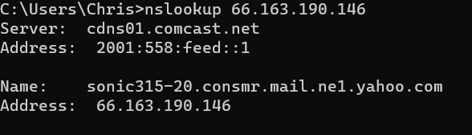
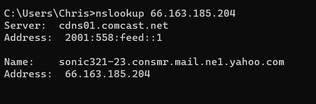

# Email forensics assignment 

**Source:** [`Email_forensics_assignment_.pdf`](../archive/canvas-submissions/Email_forensics_assignment_.pdf)  
**Course:** IA 447 - Digital Forensics I (EMU)  
**Author:** Julio Barros

## Page 1

Email forensics assignment 
 
Working with Flat Email files 
o - turn on view file extensions in VM 
o Download my order.txt and Potential Business.txt from Canvas 
1. Hey buddy.txt  - The suspect is accused of sharing sensitive corporate information for a company 
that makes gears. 
• Sender and receiver of the email (if available) 
Sender: iasuspectjunk@gmail.com 
• Name of anyone else who has a copy (if available) 
• The IP address and the domain name of the designated SMTP server  
IP: ima_spy@yahoo.com designates 66.163.190.146 as permitted sender 
name of the designated SMTP server : ima_spy@yahoo.com 
• DKIM information 
dkim=pass header.i=@yahoo.com header.s=s2048 header.b="WaHeyM/n"; 
       spf=pass (google.com: domain of ima_spy@yahoo.com designates 66.163.190.146 as 
permitted sender) smtp.mailfrom=ima_spy@yahoo.com; 
       dmarc=pass (p=REJECT sp=REJECT dis=NONE) header.from=yahoo.com 
• Date email received 
  Wed, 5 Apr 2023 07:42:33 -0700 (PDT) 
 
• screengrabs of the attachment

## Page 2

• DNS Lookup the mail servers 
 
 
 
2. Something for you.txt – The suspect is accused of passing “kitty” pornography through email 
• Sender and receiver of the email (if available) 
Sender: iasuspectjunk@gmail.com 
• Name of anyone else who has a copy (if available) 
• The IP address and the domain name of the designated SMTP server  
domain name of the designated SMTP server:ima_spy@yahoo.com designates 66.163.185.204 
as permitted sender 
IP: 66.163.185.204 
 
• DKIM information 
dkim=pass header.i=@yahoo.com header.s=s2048 header.b=rR+Yl+BI 
• Date email received 
Wed, 5 Apr 2023 07:57:20 -0700 (PDT)

## Page 3

• screengrabs of the attachment 
 
• DNS Lookup the mail servers

