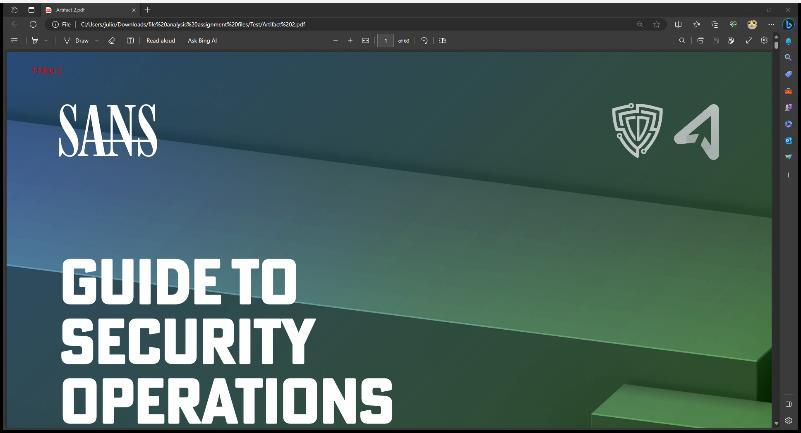
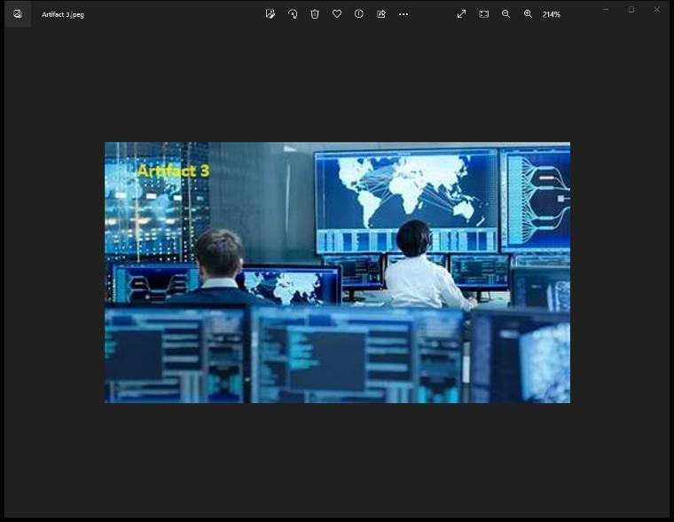
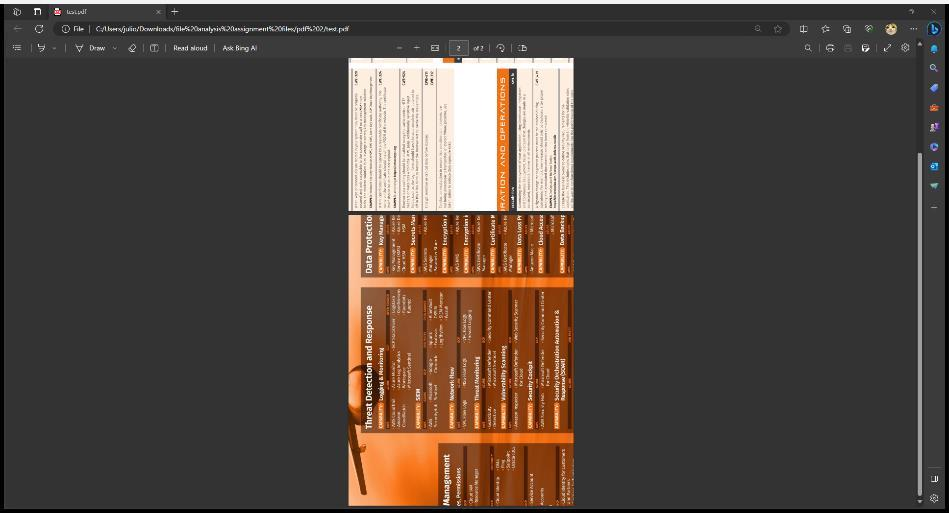
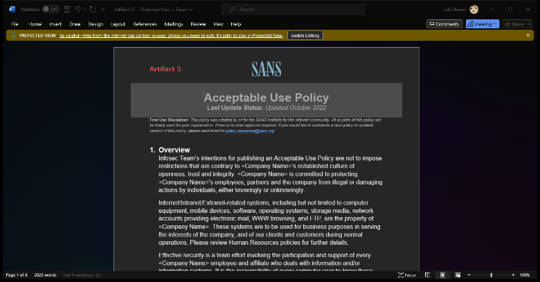
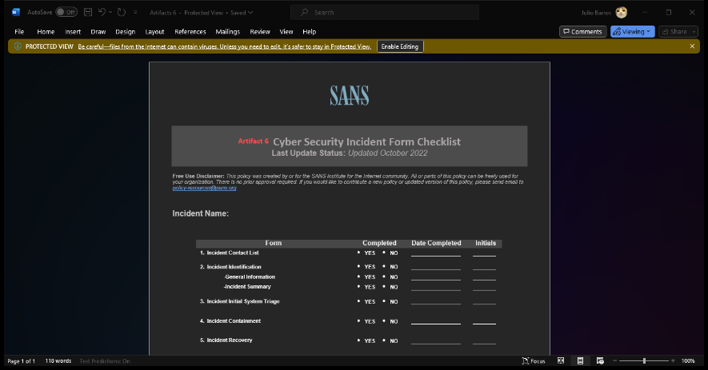

# File signature and steganography  assignment

**Source:** [`File signature and steganography  assignment.pdf`](../archive/canvas-submissions/File%20signature%20and%20steganography%20%20assignment.pdf)  
**Course:** IA 447 - Digital Forensics I (EMU)  
**Author:** Julio Barros

## Page 1

File Signature analysis/Magic number Assignment 
22 points (see rubric on Canvas) 
• Work on your own. 
• Use professional image sizes and report spacing.  
• There are 6 artifacts.  Review Rubric as needed 
• Each artifact is marked with an A and a number.   
• YOUR DOCUMENT MUST LIST THE EVIDENCE YOU LOCATE IN ORDER BY Artifact number. 
• For this assignment, we do not need hash numbers or comments. 
• Download and perform file analysis on  “File Analysis Assignment files.zip” located on Canvas. 
==================================================================== 
 
1. Artifact 2 
a. Inside SANS_Security_Operations pdf file. 
b. Was changed on the hex. 
c. I need to change the hex to have access.

## Page 2

2. Artifact 3 
a. JFIF File. 
b. Hided on PDF file SANS_Security_Operations 
 
 
3. Artifact 4 
a. Inside SWAT poster.pdf 
b. Actually hex was not set up as pdf, I had to change manually using (25 50 44 46 2D)

## Page 3

4. Artifact 5 
a. There is no excel file. 
b. The extension was changed intentionally. 
c. Content of the docx file. 
 
 
 
5. Artifact 6 
a. File open normally  
i. Is a docx file.

