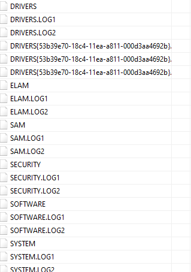
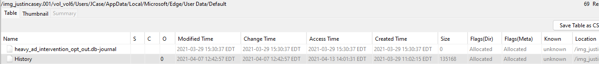
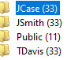
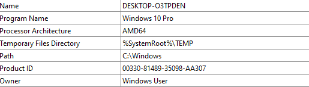
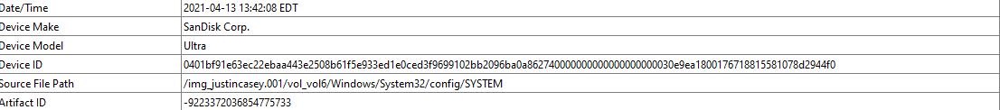

# Justin Casey

**Source:** [`Justin Casey.pdf`](../archive/canvas-submissions/Justin%20Casey.pdf)  
**Course:** IA 447 - Digital Forensics I (EMU)  
**Author:** Julio Barros

## Page 1

Name: Julio Barros 
Case: Justin Casey  
10  Points 
 
Intellectual property (IP) commonly stolen includes customer lists, secret formulas, source codes, 
strategy documents, and other trade secrets.  In this case, “Justin Case” is being investigated due 
to his strange behavior before leaving the BigaCorp company. BigaCorp is a builder of new 
technology. It appears that Justin was frantically copying files and planning a trip abroad after he 
announced he was leaving the company. After leaving BigaCorp, Justin works at a company that 
competes directly with his past position. A BigaCorp colleague has mentioned to management 
that Justin was also considering moving abroad. Given the type of work Justin is now doing 
along with the similar material he is producing, BigaCorp feels he has stolen IP from the 
company. They also believe his plan to travel abroad may be based on escaping legal issues by 
fleeing to a foreign country.   BigaCorp has an image of Justin’s computer and an image of a 
thumb drive found hidden in his old office. The thumb drive itself would be a violation of 
company policy if it were inserted into a company computer. We’ve been asked to review the 
artifacts for IP theft and foreign travel evidence. 
 
This is only an exercise in Registry exploration ( you will find other files, but please ignore 
everything that is not registry) 
 
In this case, you will inspect the image of his computer and export the registry keys  
 
 
1)  Registry analysis 
a.   Export the six registry keys and screengrab here.  
i. Where were the files found? 
(describe the path)  
Vol6 >Windows>System32>config 
ii. Screengrab exported files in a 
directory

## Page 2

b.   Review the last “typed URLs” for the case account (screengrab). Casey uses 
Internet Explorer 11 
i. What action did you take? 
Vol_vol6/JCase/AppData/Local/Microsoft/Edge/User Data/Default 
ii. Screengrab registry entry 
 
 
c.   Using your tool of choice, answer the following questions: 
i.   What is the IP address of the local connection? 
1.   Address:  
2.   Screengrab: 
3.  Was DHCP used 
4.  Screen grab of DHCP server address

## Page 3

2, .   Identify all users of the computer (screengrab) 
1. How many users? 4 
2. Screengrab: 
 
 
3.  Identify the computer OS and build number 
1.  OS? 
2.  Screengrab(s) 
 
4.  Was a USB device was placed into the Casey computer. 
 1.  Y/N ? 
 Yes 
3. Serial number  and model/brand 
SanDisk Ultra 
 3. Screengrab

