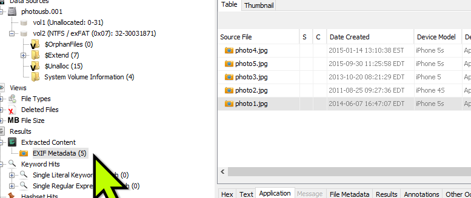

# Photo Exif excercise

**Source:** [`Photo Exif excercise.pdf`](../archive/canvas-submissions/Photo%20Exif%20excercise.pdf)  
**Course:** IA 447 - Digital Forensics I (EMU)  
**Author:** Julio Barros

## Page 1

Name : __Julio Barros_____________________________________ 
 
Watch the video on how to review EXIF data in Autopsy first! 
 
Photo analysis 
We’ve been asked to review the photos of user John Tomas.  HR has provided a BIT-Stream copy of his 
USB drive (John Thomas Photo USB.Rar).  Extract The John Tomas case and import it into Autopsy like 
you have other cases.  You must let all Autopsy ingests load – this is the progress bar in the bottom right 
corner.  It will take a bit of time to complete.  Your import should look like the image below. 
 
 
Use a red colored font for our answers below 
Photo 1  
1. What Phone type took this picture? iPhone 5s 
2. When was the picture taken? 2014:06:07 16:47:07 
3. Was the picture taken with the front or back lens? Back lens 
4. What were the GPS coordinates of the camera/phone when the picture was taken?  
Latitude: 42.727000000000004 
Longitude: -78.81374444444444 
5. Put the coordinates into Google Maps and screengrab the map?  
298-112 Sherburn Dr, Hamburg, NY 14075 
6. What other photos were taken with the phone within 1 year (timeline)? One photo was taken in 
2015. 
• Note – notice within the timeline we could look at many things.  Web activity on the phone, 
downloads, etc.  Under Misc Types – we could get GPS routes, location history, and email. 
• We’re not looking for items outside of the photo in this exercise, but make sure you 
understand the tool for future casework. 
Photo 2 
1. When was the picture taken? 2011:08:25 09:27:36 
2. What Camera/Phone type took this picture? Apple iPhone 4s with the back camera. 
3. Where was the camera/phone when the picture was taken? The phone was in Cook's Meadow 
Loop, Yosemite Valley, CA 95389

## Page 2

4. Does anything in the Exif data of photo 2 indicate data was manipulated by third-party tool? Yes, 
the photo has been modified in 2023. And there is a huge difference of size between photos. 
5. Was the picture taken with the front or back lens? Back 
6. What other photos were taken with the phone within 1 year (timeline)? No, all photos were 
taken after 2 or 3 years. 
 
 
Photo 3 
7. When was the picture taken? 2013-10-20 08:21:29 
8. What Camera/Phone type took this picture? Apple iPhone 5 
9. Where was the camera/phone when the picture was taken? Mississauga, ON L5C 1E3, Canada 
10. Does anything in the Exif data of photo 2 indicate data was manipulated by third-party tool? No. 
11. Was the picture taken with the front or back lens? Back lens 
12. What other photos were taken with the phone within 1 year (timeline)? Yes, Photo #1 was taken 
in 2014. 
Photo 4 
13. When was the picture taken? 2015:01:14 13:10:38 
14. What Camera/Phone type took this picture? Apple iPhone 5s  
15. Where was the camera/phone when the picture was taken? In a Beach, but I couldn’t find the 
Geolocation. 
16. Does anything in the Exif data of photo 2 indicate data was manipulated by third-party tool? Yes, 
says has been modified. 
17. Was the picture taken with the front or back lens? Back lens 
18. What other photos were taken with the phone within 1 year (timeline)? Yes, photo #1 was taken 
in 2014 July. 
Photo 5 
19. When was the picture taken? 2015:09:30 11:25:58 
20. What Camera/Phone type took this picture? Apple iPhone 5s 
21. Where was the camera/phone when the picture was taken? Osceola County, FL 
22. Does anything in the Exif data of photo 2 indicate data was manipulated by third party tool? Yes. 
23. Was the picture taken with the front or back lens?  Back Lens
