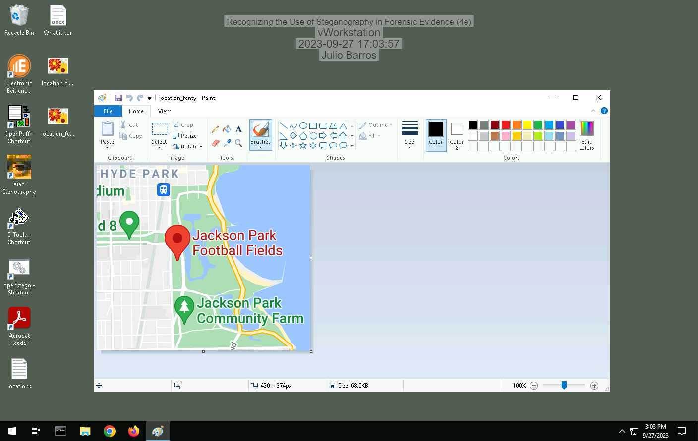
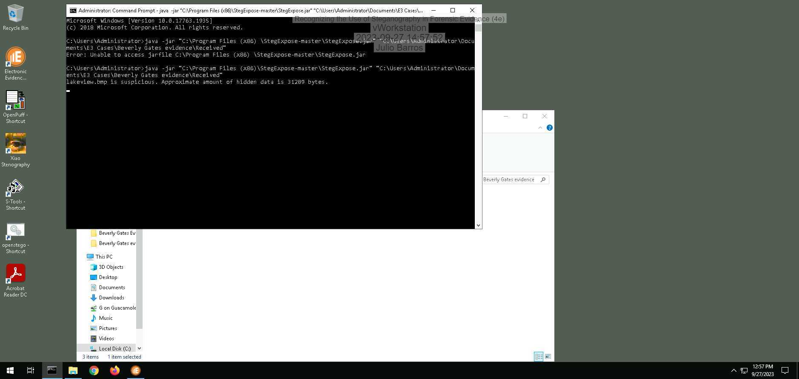
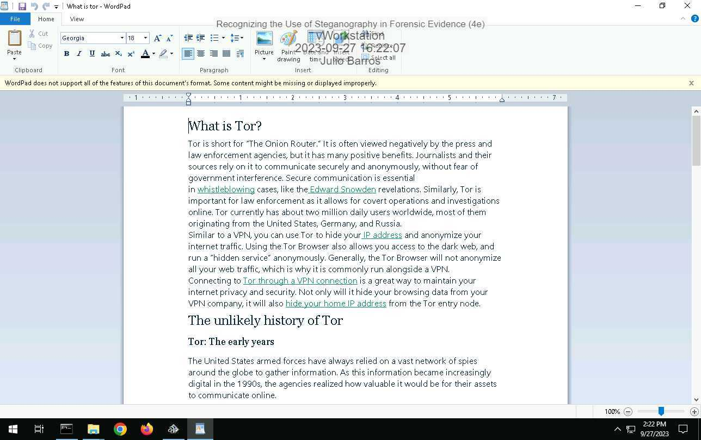
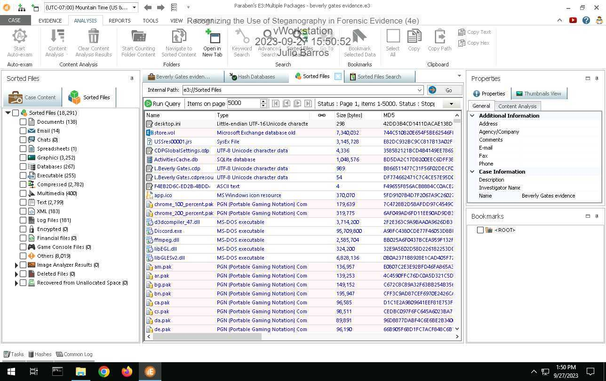
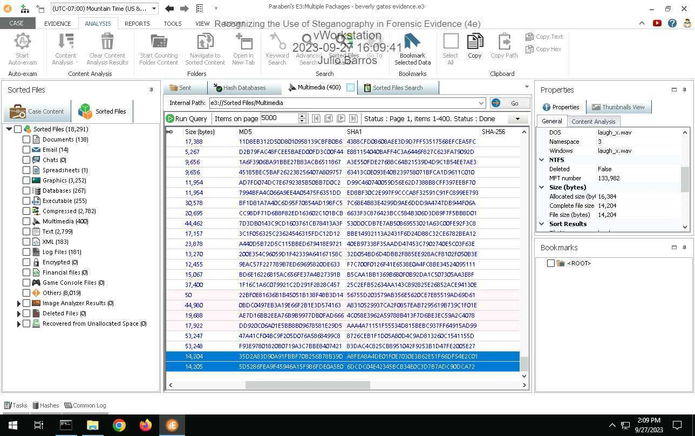
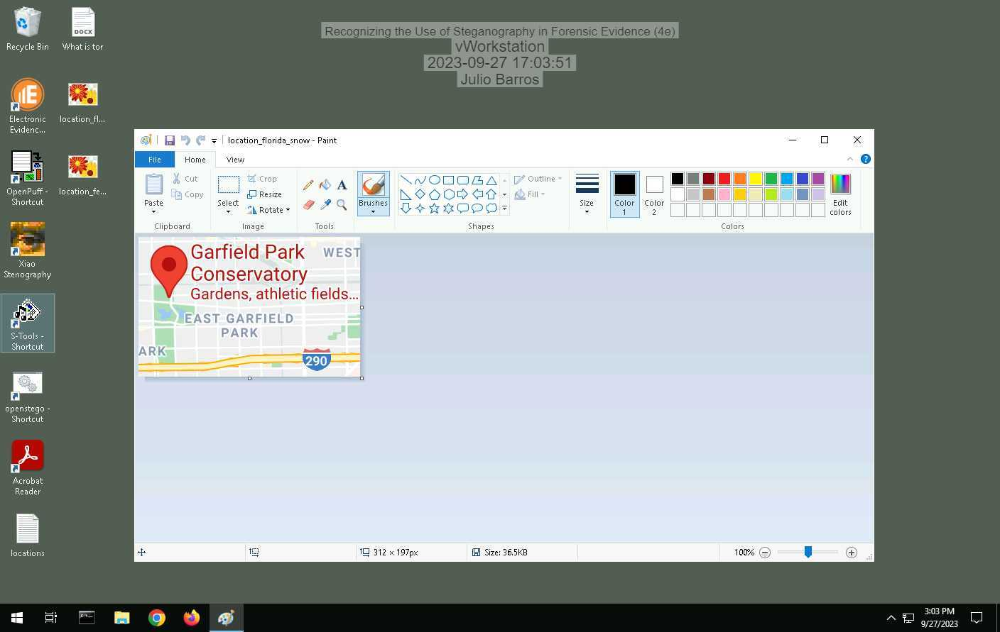
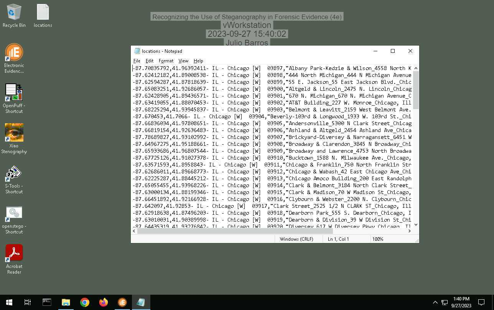
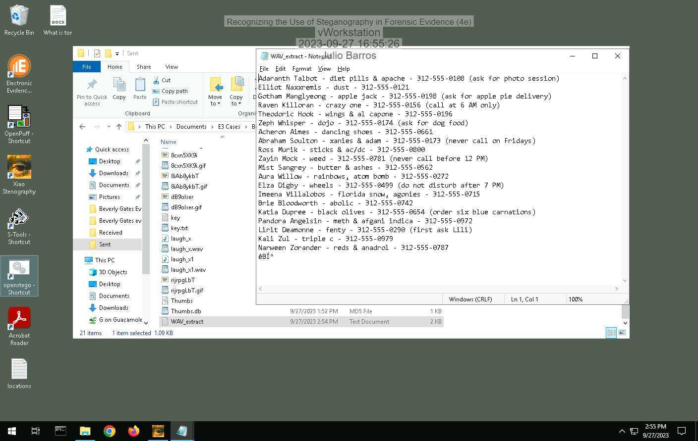
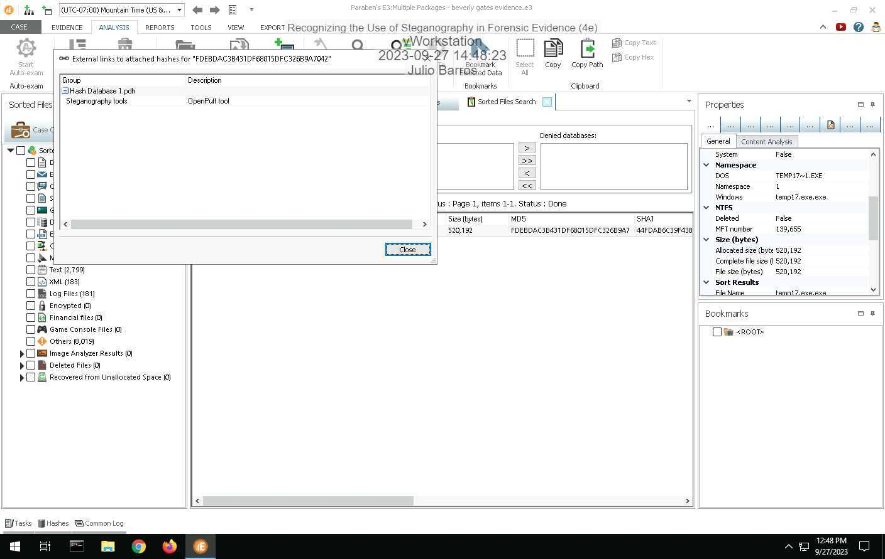
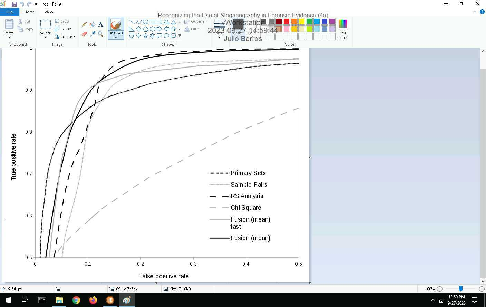

# Recognizing the Use of Steganography in Forensic Evidence 4e - Julio Barros

**Source:** [`Recognizing_the_Use_of_Steganography_in_Forensic_Evidence_4e_-_Julio_Barros.pdf`](../archive/canvas-submissions/Recognizing_the_Use_of_Steganography_in_Forensic_Evidence_4e_-_Julio_Barros.pdf)  
**Course:** IA 447 - Digital Forensics I (EMU)  
**Author:** Julio Barros

## Page 1

Recognizing the Use of Steganography in Forensic Evidence (4e)
Digital Forensics, Investigation, and Response, Fourth Edition - Lab 02
Student: Email:
Julio Barros
Time on Task: Progress:
2 hours, 55 minutes 100%
Report Generated: Wednesday, September 27, 2023 at 5:04 PM
Section 1: Hands-On Demonstration
Part 1: Detect Steganography Software on a Drive Image
14. Make a screen capture showing the search result and its description.
Part 2: Detect Hidden Data in Image Files
Page 1 of 8

## Page 2

Recognizing the Use of Steganography in Forensic Evidence (4e)
Digital Forensics, Investigation, and Response, Fourth Edition - Lab 02
10. Make a screen capture showing the StegExpose results.
13. Make a screen capture showing the suspicious file in Microsoft Paint.
Part 3: Extract Hidden Data from Image Files
2. Record the passphrase saved in the ReadMe file.
landmarks
Page 2 of 8

## Page 3

Recognizing the Use of Steganography in Forensic Evidence (4e)
Digital Forensics, Investigation, and Response, Fourth Edition - Lab 02
16. Make a screen capture showing the contents of the file extracted by OpenPuff.
17. Describe the contents of the hidden file. How might it be relevant to the current investigation?
The file contains locations and names from other people
Page 3 of 8

## Page 4

Recognizing the Use of Steganography in Forensic Evidence (4e)
Digital Forensics, Investigation, and Response, Fourth Edition - Lab 02
Section 2: Applied Learning
Part 1: Detect Steganography Software on a Drive Image
5. Make a screen capture showing the search result and its description.
Part 2: Detect Hidden Data in Image and Audio Files
4. Identify the image file with concealed data according to the StegExpose steganalysis tool.
dB9olser.gif is the suspicious file
Page 4 of 8

## Page 5

Recognizing the Use of Steganography in Forensic Evidence (4e)
Digital Forensics, Investigation, and Response, Fourth Edition - Lab 02
7. Make a screen capture showing the WAV file sizes and hash values in E3.
Part 3: Extract Hidden Data from Image and Audio Files
9. Make a screen capture showing the contents of the hidden file extracted by S-Tools.
Page 5 of 8

## Page 6

Recognizing the Use of Steganography in Forensic Evidence (4e)
Digital Forensics, Investigation, and Response, Fourth Edition - Lab 02
15. Make a screen capture showing the contents of the hidden file extracted by Xiao.
16. Describe the contents of the two hidden files. How might they be relevant to the current
investigation?
The files gives personal information, so that can be relevant to the investigation since now we have
names to look up
Page 6 of 8

## Page 7

Recognizing the Use of Steganography in Forensic Evidence (4e)
Digital Forensics, Investigation, and Response, Fourth Edition - Lab 02
Section 3: Challenge and Analysis
Part 1: Detect More Hidden Data
Record the names of the files that contain concealed data.
There are two suspicious files. 
chicago.bmp
chicago1.bmp
Part 2: Extract More Hidden Data
Make a screen capture showing the first file extracted by OpenStego.
Page 7 of 8

## Page 8

Recognizing the Use of Steganography in Forensic Evidence (4e)
Digital Forensics, Investigation, and Response, Fourth Edition - Lab 02
Make a screen capture showing the second file extracted by OpenStego.
Powered by TCPDF (www.tcpdf.org)
Page 8 of 8

