# Recovering Deleted and Damaged Files 4e - Julio Barros

**Source:** [`Recovering_Deleted_and_Damaged_Files_4e_-_Julio_Barros.pdf`](../archive/canvas-submissions/Recovering_Deleted_and_Damaged_Files_4e_-_Julio_Barros.pdf)  
**Course:** IA 447 - Digital Forensics I (EMU)  
**Author:** Julio Barros

## Page 1

Recovering Deleted and Damaged Files (4e)
Digital Forensics, Investigation, and Response, Fourth Edition - Lab 03
Student: Email:
Julio Barros
Time on Task: Progress:
2 hours, 3 minutes 100%
Report Generated: Wednesday, October 11, 2023 at 5:11 PM
Section 1: Hands-On Demonstration
Part 1: Recover Deleted Files from an NTFS Drive Image with E3
13. Make a screen capture showing the list of recovered files and folders in the E3 Trash
folder.
Page 1 of 10

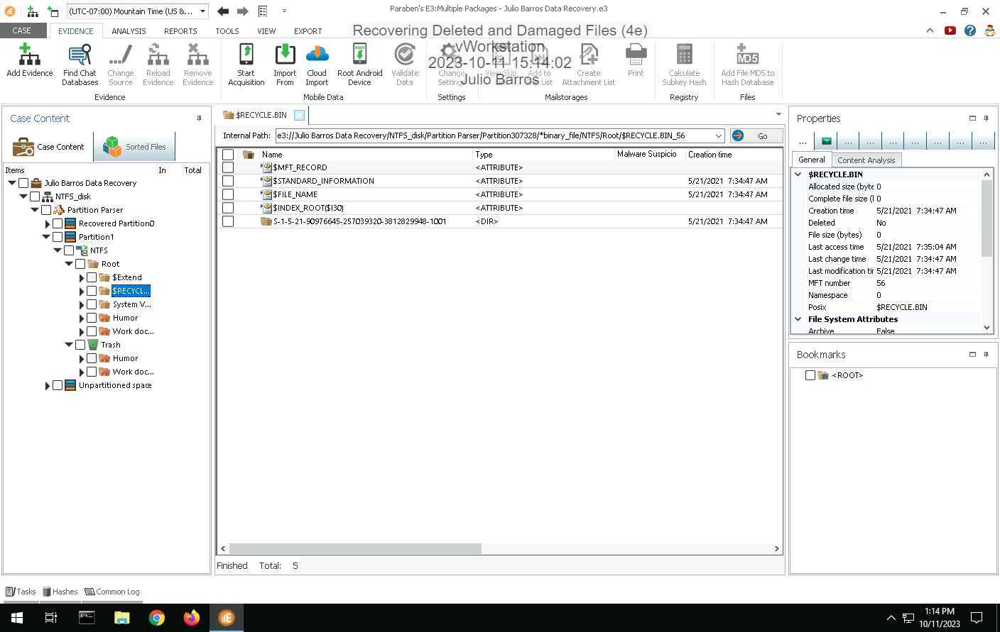

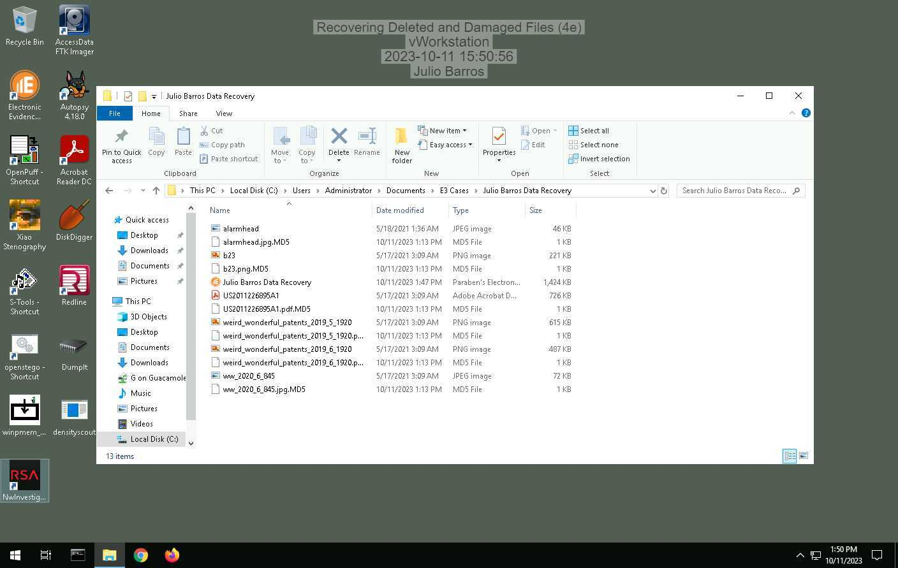

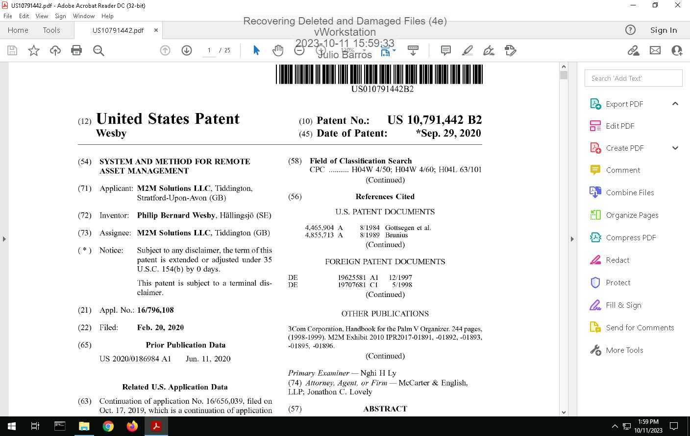

## Page 2

Recovering Deleted and Damaged Files (4e)
Digital Forensics, Investigation, and Response, Fourth Edition - Lab 03
20. Make a screen capture showing the patent file in the File Viewer.
25. Make a screen capture showing the recovered files in the File Explorer.
Part 2: Recover Deleted Files from an Ext4 Drive Image with Autopsy
Page 2 of 10

## Page 3

Recovering Deleted and Damaged Files (4e)
Digital Forensics, Investigation, and Response, Fourth Edition - Lab 03
14. Make a screen capture showing the contents of the list of deleted files in Autopsy.
22. Make a screen capture showing the recovered patent file.
Page 3 of 10

## Page 4

Recovering Deleted and Damaged Files (4e)
Digital Forensics, Investigation, and Response, Fourth Edition - Lab 03
Section 2: Applied Learning
Part 1: Recover Deleted Files in Windows with DiskDigger
9. Make a screen capture showing the deleted patent file in DiskDigger.
15. Make a screen capture showing the recovered patent file.
Page 4 of 10

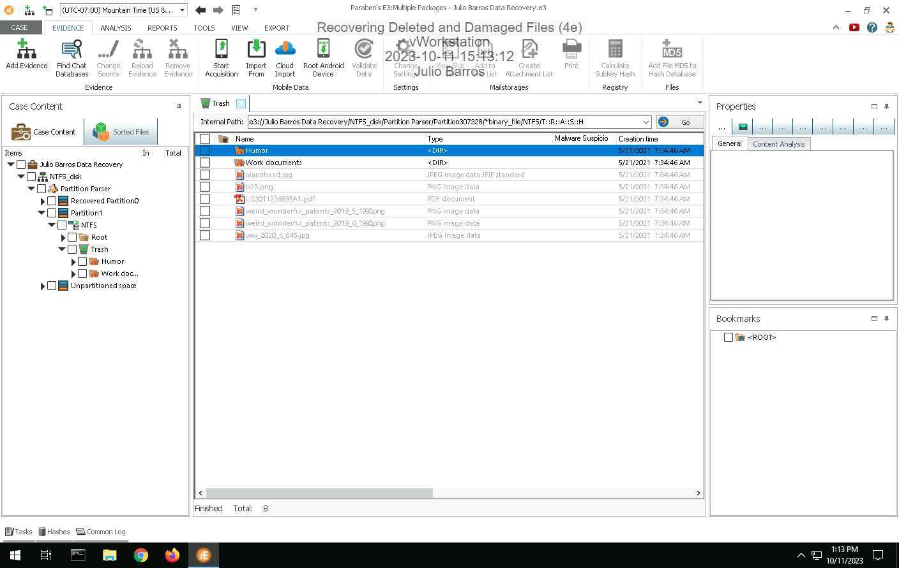

## Page 5

Recovering Deleted and Damaged Files (4e)
Digital Forensics, Investigation, and Response, Fourth Edition - Lab 03
Part 2: Recover Deleted Files in Linux with PhotoRec
9. Make a screen capture showing the contents of the RAR archive in the
/mnt/media/home/ash directory.
Page 5 of 10

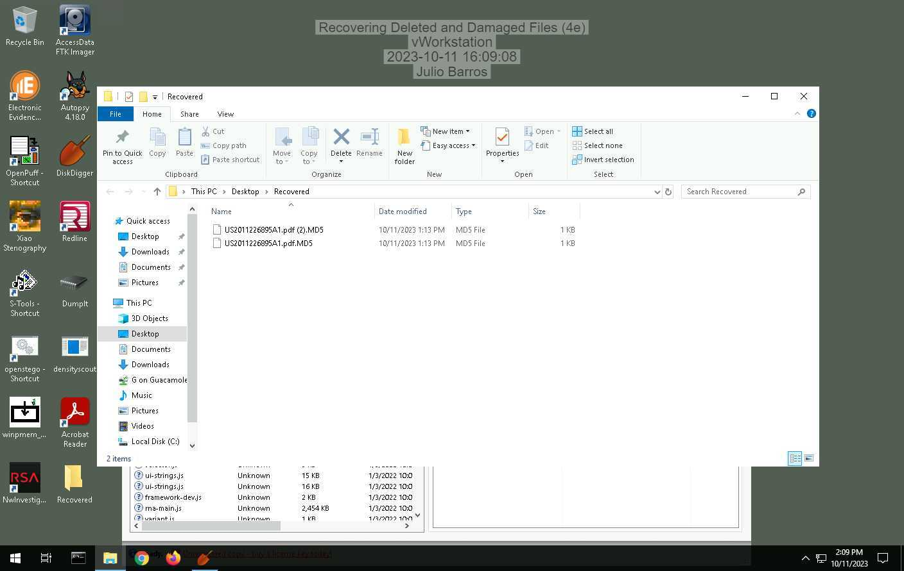

## Page 6

Recovering Deleted and Damaged Files (4e)
Digital Forensics, Investigation, and Response, Fourth Edition - Lab 03
15. Make a screen capture showing the failed mount attempt on the /dev/sdb2 device.
Page 6 of 10

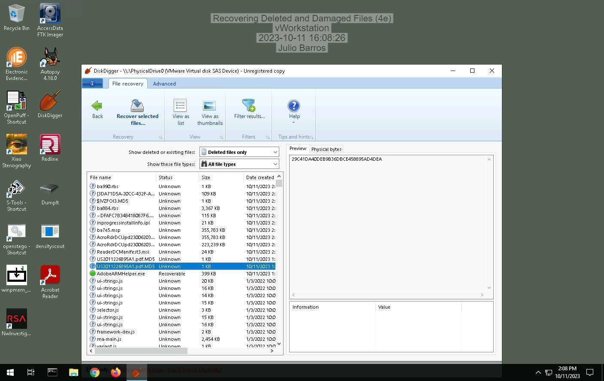

## Page 7

Recovering Deleted and Damaged Files (4e)
Digital Forensics, Investigation, and Response, Fourth Edition - Lab 03
32. Make a screen capture showing the compressed files recovered by PhotoRec.
Page 7 of 10

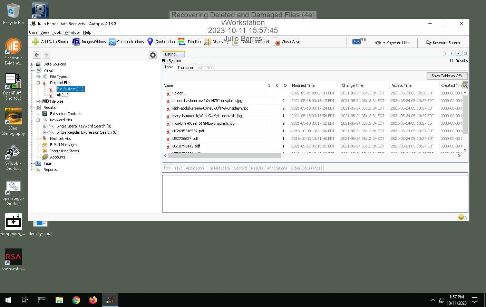

## Page 8

Recovering Deleted and Damaged Files (4e)
Digital Forensics, Investigation, and Response, Fourth Edition - Lab 03
35. Make a screen capture showing the backup files recovered from the RAR archive.
Page 8 of 10

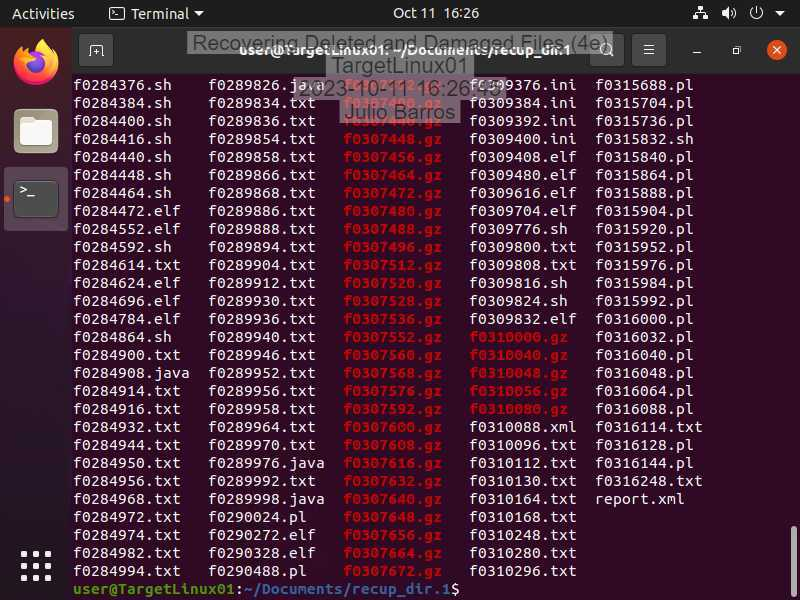

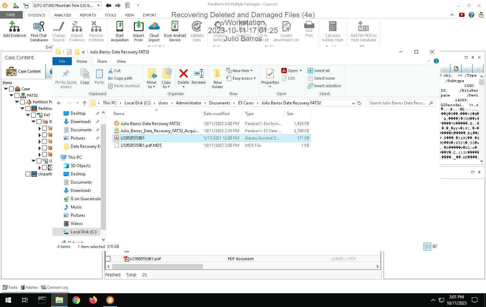

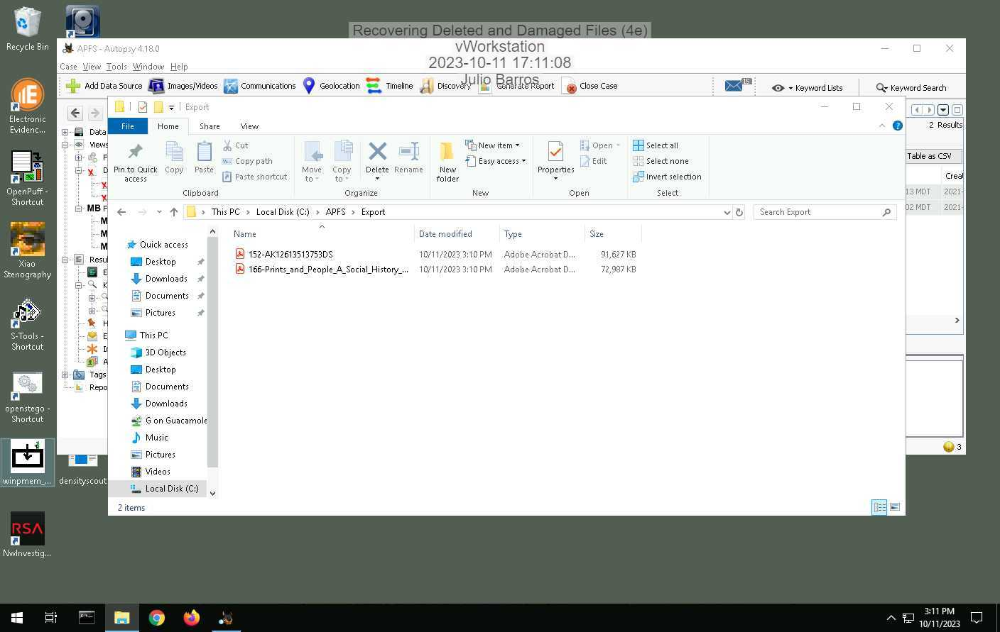

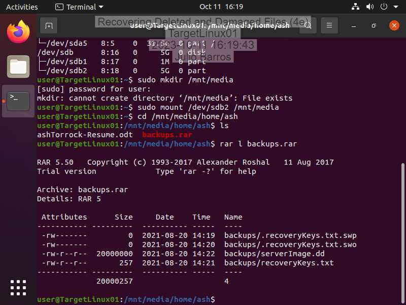

## Page 9

Recovering Deleted and Damaged Files (4e)
Digital Forensics, Investigation, and Response, Fourth Edition - Lab 03
Section 3: Challenge and Analysis
Part 1: Recover Deleted Files from a FAT Drive Image
Make a screen capture showing the patent file recovered from the FAT32 drive image within E3.
Part 2: Recover Deleted Files from a APFS Drive Image
Page 9 of 10

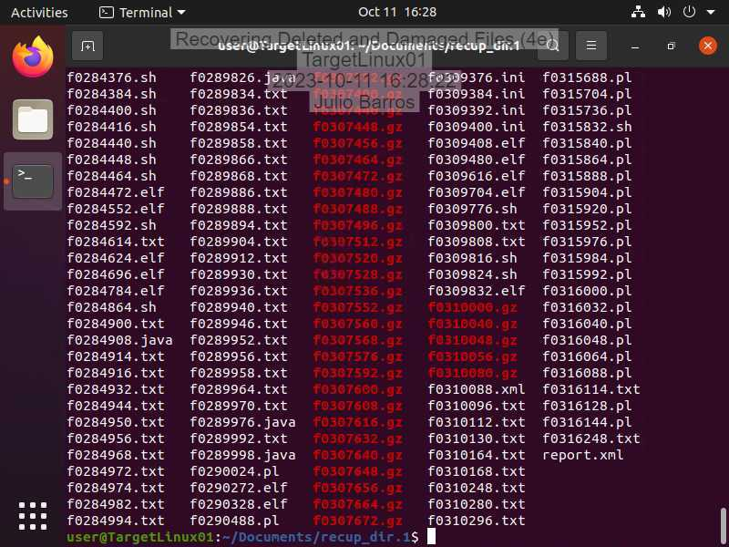

## Page 10

Recovering Deleted and Damaged Files (4e)
Digital Forensics, Investigation, and Response, Fourth Edition - Lab 03
Make a screen capture showing the patent file recovered from the APFS drive image within
Autopsy.
Powered by TCPDF (www.tcpdf.org)
Page 10 of 10

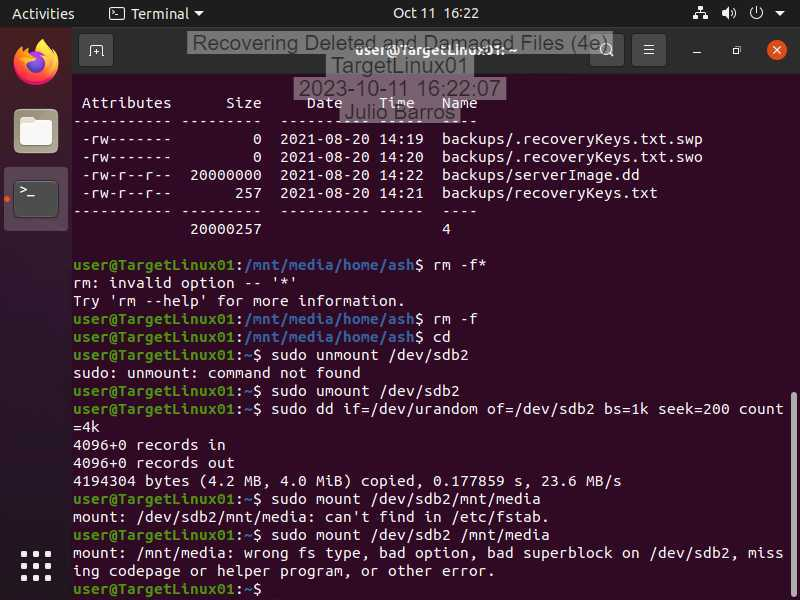
