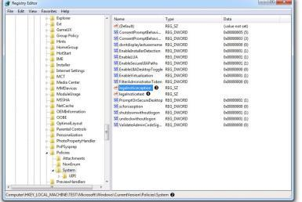
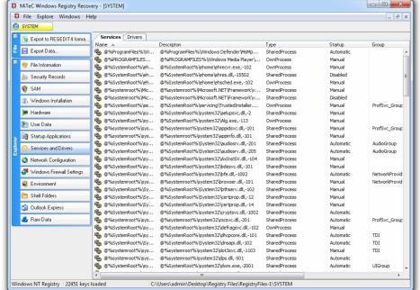
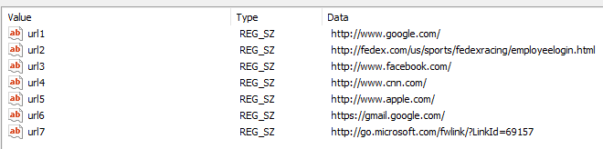
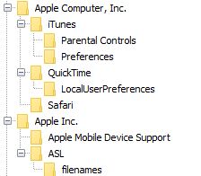
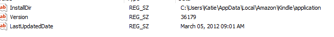

# Registry lab

**Source:** [`Registry lab.pdf`](../archive/canvas-submissions/Registry%20lab.pdf)  
**Course:** IA 447 - Digital Forensics I (EMU)  
**Author:** Julio Barros

## Page 1

Name: Julio Barros 
 
This is a walkthrough lab, there will not be a corresponding video.   
 
Activity 1:  How to read an offline Registry file with Windows Registry Recovery. 
 
Read) ARTIFACTS IN THE REGISTRY Aside from containing configuration settings for a Windows-
based system, the Windows Registry contains a wealth of data about system usage. Users might 
think twice if they knew how much information is retained in the collective set of files known as 
the Registry. Since manipulating the Registry is something the typical computer user does not 
do, the data found in the Registry is considered inherently more reliable (although not perfect) 
than user data files. Two of the 4N6 goals  with analyzing the Registry are: 1. Knowing what 
data stored in the Registry 2. Retrieving the data in a usable format. On Windows-computer 
systems with large storage capacities, some investigators find examining the Registry to be an 
effective triage, because it is easier to recover all of the Registry files and focus on them rather 
than physically acquiring a multi-terabyte drive.  
The Windows Registry is compromised of the following data files: 
C:\Windows\system32\config\default C:\Windows\system32\config\SAM 
C:\Windows\system32\config\SECURITY C:\Windows\system32\config\software 
C:\Windows\system32\config\system C:\Users\username\NTUSER.DAT (for each user profile on 
the system)  
When the files are loaded into memory, the Registry takes the form of:  
HKEY_CLASSES_ROOT  
HKEY_CURRENT_USER  
HKEY_LOCAL_MACHINE  
HKEY_USERS  
HKEY_CURRENT_CONFIG  
The activities presented here will examine a number of popular Registry entries, but clearly not 
all artifacts. 
 
Instructions Activity 5 (DO) 
 
Should be installed already, but if not …… 
Reading Offline Registry Files with Regedit 
Product: Regedit Manufacturer: Microsoft Corporation Web site: 
https://msdn.microsoft.com/en-us/library/windows/desktop/ms724871(v=vs.85).aspx  
 
Warning: Please be extremely careful, when using Regedit. Changes made to the active Registry 
can cause unstable conditions in Windows.   
1. Download the file called “RegistryFiles-1.zip” from filePack and extract the contents of the 
compressed file to your desktop.  
2. Open a command prompt on a Windows computer.  
3.  fire up RegEdit 
4. When the Registry Editor launches, ensure all keys are collapsed.

## Page 2

5. In the Regedit window, left click on HKEY_LOCAL_MACHINE. It will highlight. Do not open it.  
6. From the main menu select “File” and then select “Load Hive…” from the pull-down menu. (If 
HKEY_LOCAL_MACHINE is not highlighted, this menu item will not appear.)  
7. Browse to the directory on the desktop with the Registry files -1 retrieved from filepack. 
Select the file called SOFTWARE. When loading the file, you will be prompted to enter a name in 
the “Load Hive” window. Enter the name “TEST” and click the “OK” button.  
 
8. Expand HKEY_LOCAL_MACHINE.  
The loaded hive will appear with the name TEST. Confirm the logon banner contained within the 
Windows Registry of the TEST hive by navigating down to the following Registry key: 
HKEY_LOCAL_MACHINE\TEST\Microsoft\Windows\CurrentVersion\Policies\System  
 
9. After navigating down to the key, the path will be displayed in the lower left corner of the 
screen as shown below: 
 
 
Notice two keys: legalnoticecaption and legalnoticetext. The former would contain the text 
value, which appears in the title bar of the consent banner. The latter is the actual message 
contained within the body of the consent banner. 
10) What consent banner is shown on this computer? No consent banner is displayed based on 
the empty values in this Registry file – you know this by double clicking the legalnoticecaption 
and finding “value data” empty. (In this hive, the consent banner has been removed and nothing 
will be displayed at logon. The absence of the banner may cause legal concerns during the 
examination of corporate assets. In this example the absence of data is a finding.) If a banner is 
found, it proves the user was informed of policies that were listed. 
 
11. Navigate to the following key to identify the installation information for the versions of  
Windows: HKEY_LOCAL_MACHINE\TEST\Microsoft\Windows NT\CurrentVersion (product 
name) 
12. What is the name of the Windows product? Eddie 
13. What is the product ID number? 00371-868-0000007-85715 
14. In what directory on the system is the operating system running (system root)? C:\Windows

## Page 3

15. what is the OS edition?  
16. Collapse the Registry keys.  
17. Click on the key named TEST. From the main menu select “File” and then choose “Unload 
Hive…” 
 
1) Activity 6: Reading Offline Registry Files with Windows Registry Recovery 
Tools: Product: MiTeC Windows Registry Recovery  
WRR is part of the file pack 
 
Instructions:  
1. We’ll be working with the same files from “RegistryFiles-1.zip”  
2. Download Windows Registry Recovery and extract the executable from the compressed file 
and place it on your desktop.  
3. Launch Windows Registry Recovery.  
4. Select " File " From the main menu and then “Open.” Choose the SYSTEM Registry hive.  
5. On the menu on the left side of the screen click the “Services and Drivers” button. A list of 
services located in the SYSTEM hive will be displayed as shown below: 
 
6. On the menu on the left side of the screen click the “Network Configuration” button.  
7. In the right frame, click the “TCP/IP” tab. The network information from the Registry including 
the IP address will be displayed. 
8. What is the IP address of the computer?  
 A) is it a static address or DHCP? 
 
 B) what is the default gateway?  
 
 
9. From the main menu select “File” and then select “Open.” Browse to the SAM file.  
10. After the SAM file loads, click the “SAM” button on the left side of the window.  
11. On the right side of window click the “Groups and Users” tab.

## Page 4

12. What are the account names on this computer?  MR-E 
13.  When was the Jimmy account last logon?  
We’ll continue with: MiTeC Windows Registry Recovery 
1. Using the same registry in the previous activity, open NTuser.dat 
2. Select the NTUSER.dat file in HKEY_USERS 
3. Identify a location to save the output. 
4. open to process the Registry file. 
5. under raw data\software\microsoft\internet explorer\typed urls 
 Screen grab the url names that were last typed into this computer using internet 
explorer. 
  
6. Was a USB drive ever used on this computer? No 
 System\raw data\controlset1\usbstor\ 
 
7.  From “RegistryFiles-2”. We will work with the artifacts from the two files SYSTEM and 
NTUSER.dat.  
a. What was the local area  IP address assigned to the computer?  
 
b. Were there at least 10 USB drives plugged into this machine  
No only 4 
C. What is the serial number of the iPod that was plugged into the computer? 
 I couldn’t find the serial number 
 
d. Search through the NTUSER.dat file. Was an Amazon Kindle connected to this 
computer? if so, when was the last synch? (check user settings in Raw data\software)

