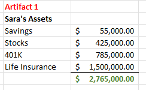
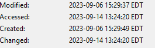

# Sara Miles case (1)

**Source:** [`Sara Miles case (1).pdf`](../archive/canvas-submissions/Sara%20Miles%20case%20(1).pdf)  
**Course:** IA 447 - Digital Forensics I (EMU)  
**Author:** Julio Barros

## Page 1

IA-427 
Forensics Report 
Internal Case 
Montgomery Case, Ch 1 
Incident Status: CLOSED 
Report written by: 
Julio Barros 
Revision: 1 
•  
 
 
 
1   Contents 
2      Executive Summary & Nature of the case ............................................................................................ 2 
 
3      Incident Discovery................................................................................................................................. 3 
 
3.1       Summary ....................................................................................................................................... 3 
 
3.2       Action Items .................................................................................................................................. 3 
 
3.3       Description of system(s) in question ............................................................................................ 3 
 
4      Forensics Process .................................................................................................................................. 4 
 
4.1.       List all tools out here in order of document Error! Bookmark not defined. 
 
4.2       Evidence to Analyze ...................................................................................................................... 5 
 
5      Results and Findings.............................................................................................................................. 5 
 
5.1       Summary ....................................................................................................................................... 5 
 
5.2       Analysis of recovered data............................................................................................................ 6 
 
5.2.1         
5.2.2         
 
5.2.3

## Page 2

IA-427 
Forensics Report 
Internal Case 
Montgomery Case, Ch 1 
Incident Status: CLOSED 
Report written by: 
Julio Barros 
Revision: 1 
•  
 
 
 
2   Executive Summary 
Sarah Miles has been found dead in her apartment and police suspect foul play.  David Banner, Sarah’s 
boyfriend of 2 years, is a suspect and you have been asked to perform a digital investigation of the 
provided USB image.  The USB was found in David’s apartment, and a forensic copy has been made for 
your review.  The USB and original image are under police control, and the chain of custody is intact. The 
police suspect David may be involved as he was heard arguing with Sarah the night before she was found. 
 
 
Nature of the case: Suspicious death

## Page 3

IA-427 
Forensics Report 
Internal Case 
Montgomery Case, Ch 1 
Incident Status: CLOSED 
Report written by: 
Julio Barros 
Revision: 1 
•  
 
 
3   Incident Discovery 
3.1 Summary  
3.2    Action Items – investigation artifacts 
 
Item to analyze Assigned to Status / Completion date 
USB Drive Julio Barros Complete 9/19/2023 
   
   
   
   
   
   
 
 
3.3 Description of system(s) in question ( in some cases you may have multiple systems 
or images) 
Type of Evidence: USB drive  
Known disk format: NTFS  
 
Type: Image 
 
Size: 512 
 
Size Bytes: 15276218464 
 
Length in Sectors:30031840

## Page 4

IA-427 
Forensics Report 
Internal Case 
Montgomery Case, Ch 1 
Incident Status: CLOSED 
Report written by: 
Julio Barros 
Revision: 1 
•  
 
4   Forensics Process 
4.1    Tools 
4.1.1 Autopsy  4.21.0  
Autopsy is an open-source digital forensics toolkit used to process images of hard drives and removable USB devices.  
 
4.1.2 WinMD5Free 1.20 
This utility was used to verify and monitor the integrity of the files during the investigation.  
 
 
4.2    Evidence to Analyze 
 
File name Checksum MD5 Status 
Suicide.txt a4e4cf61f04fec1fc9d692a2752a223e Complete 
Yacht.jpg 5cc98b12b8f9668c6fc9e2033a7d8862    Complete 
Yatcht.jpg.Zone.I
ndetifier 
34c4ed1e029ca50d4e069b3d2e2580f6  Complete 
Sarah’s 
assets.xlsx 
a8da0a45f1c3821448591c2428416bd3 Complete 
   
   
 
 
 
5   Results and Findings 
5.1    Summary 
 Provide your analysis and opinion of the Sarah Miles case. 
 
5.2    Analysis of Sarah’s Assets.xls

## Page 5

IA-427 
Forensics Report 
Internal Case 
Montgomery Case, Ch 1 
Incident Status: CLOSED 
Report written by: 
Julio Barros 
Revision: 1 
•  
 
 
Comments: Here you can see that Sarah Life Insurance was very high. 
 
5.3.  Analysis of Suicide.txt 
 
Comments: Here we can see that the supposed suicide letter was modified even after the 
murder.

## Page 6

IA-427 
Forensics Report 
Internal Case 
Montgomery Case, Ch 1 
Incident Status: CLOSED 
Report written by: 
Julio Barros 
Revision: 1 
•  
 
 
 
 
6.0 The evidence discovered on this USB device from Sarah's case suggests that it 
was a premeditated action against Sarah. The motivation behind this appears to 
be financial gain, as we have identified Sarah's assets deleted from the device, 
including her savings, stocks, and life insurance value. Based on my expert 
opinion, substantiated by the evidence, it is highly unlikely that Sarah's case was 
a suicide; rather, it appears to have been a planned murder.

