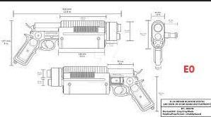
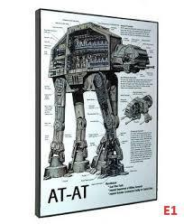
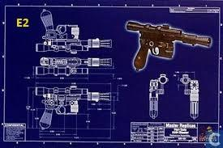
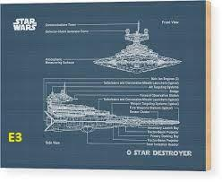
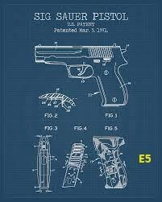
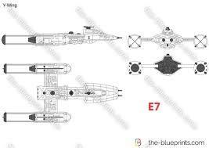
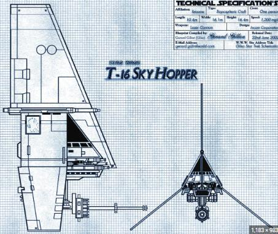

# Steganography assignment

**Source:** [`Steganography assignment.pdf`](../archive/canvas-submissions/Steganography%20assignment.pdf)  
**Course:** IA 447 - Digital Forensics I (EMU)  
**Author:** Julio Barros

## Page 1

Steganography Assignment 
20 points (see rubric on Canvas) 
• Work on your own. 
• Use professional image sizes and report spacing - Screengrabs should look like the example 
below. 
• There are 5 artifacts and 6  pieces of Evidence.  * E8 is a tough one; think it through 
• Each artifact is marked with an A and a number.  Each Evidence piece is marked with an E and a 
number.  This case holds E1,E2,E3,E5,E7, E8. 
• YOUR DOCUMENT MUST LIST THE EVIDENCE YOU LOCATE IN ORDER BY Its A#. INCLUDE an 
indented image of the evidence. Each piece of evidence should have its own outline number 
(a, b, c, etc.) SEE SAMPLE 
 
• For this assignment, we do not need hash numbers or comments. 
 
Background: John Taylor works for Really Big Weapons (RBW) and has been accused of corporate 
espionage. Specifically, his manager believes that John is hiding images of RBW intellectual property in 
family photos and distributing them to a bad actor outside the company.  You’ve been providing an 
image of John’s USB to investigate.  Any file on the USB is an artifact, and any hidden images are 
considered evidence.  We won’t be doing a formal report on this case; rather, the exercise is to cement 
your steganography skills. 
 
Sample  
1. A0  Family0.jpg 
  
a. E0 
 
 
===================================================================================== 
Your work starts here: Julio Ribeiro Barros

## Page 2

A1. 
 
E1. 
  
 
A2. 
 
E2.

## Page 3

A3. 
 
 
E3. 
 
A4. 
 
 
A5.

## Page 4

E5. 
 
 
E7. 
 
E8.

